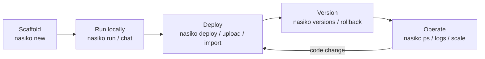

Nasiko runs agents built on any framework or language. If your container speaks [A2A](/build/a2a), Nasiko can run it, route to it, trace it, and govern the tools it calls. You don't need an SDK in your code path.

Every agent follows the same agent development lifecycle, whether it uses the OpenAI Agents SDK, LangGraph, CrewAI, Google ADK, the Anthropic SDK, or a hand-written HTTP server in Rust or Go. You can scaffold and run an agent locally without a cluster.

<Steps>
  <Step title="Scaffold">
    `nasiko new` generates an `AgentCard.json`, a `Dockerfile`, and starter source from a template. `nasiko card` keeps the card in sync with your code, and `nasiko validate` checks the project structure.
  </Step>
  <Step title="Run locally">
    `nasiko run` builds the image and starts the container on your machine. It speaks A2A as soon as it starts, so you can talk to it with `nasiko chat` before anyone else sees it.
  </Step>
  <Step title="Deploy">
    Build locally and push with `nasiko deploy`, let the Nasiko server build from source with `nasiko upload`, or deploy a published image with `nasiko import`. Every deployment is traced and receives its secrets, an LLM router credential, and an MCP gateway credential.
  </Step>
  <Step title="Version">
    Each deploy records an immutable version. `nasiko versions` shows the history and `nasiko rollback` returns to an earlier version without a rebuild.
  </Step>
  <Step title="Operate">
    List, inspect, scale, restart, and remove agents from the CLI or the **Your agents** and **Builds** screens in the dashboard.
  </Step>
</Steps>

<Tip>
  New to Nasiko? [Quickstart: deploy an agent](/quickstart-deploy) walks through the whole lifecycle in a few minutes.
</Tip>

<CardGroup cols={2}>
  <Card title="Scaffold an agent" icon="wand-magic-sparkles" href="/build/scaffold">
    Generate a project and its agent card.
  </Card>
  <Card title="Run and chat locally" icon="play" href="/build/run-locally">
    Build, run, and chat before touching a cluster.
  </Card>
  <Card title="Deploy an agent" icon="rocket" href="/build/deploy">
    Deploy, push, upload, import, or clone from GitHub.
  </Card>
  <Card title="Versions and rollback" icon="code-branch" href="/build/versions">
    Immutable versions, history, and rollback.
  </Card>
  <Card title="Operate agents" icon="gauge" href="/build/operate">
    Logs, scaling, restarts, persistent storage, teardown.
  </Card>
  <Card title="A2A agents and frameworks" icon="plug" href="/build/a2a">
    The contract your container implements.
  </Card>
</CardGroup>

## Beyond a single agent

- [Routing engine](/build/routing-engine) explains how chat without a named agent reaches the right one.
- [Workflows](/build/workflows) chain several agents into a repeatable multi-agent workflow.
- [MCP gateway](/build/mcp/overview) gives every deployed agent one endpoint for every tool a user has connected.
- [Registry](/build/registry/overview) covers the built-in image registry and the sample agents.

## Before you start

You need Docker (or Podman) and the `nasiko` CLI. See [Install the CLI and connect to a cluster](/install).
