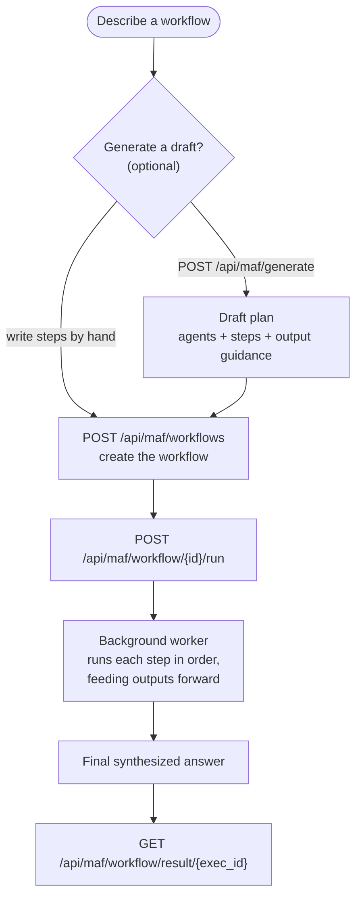

A routed chat request picks *one* agent. A **MAF (Multi-Agent Flow) workflow** is a named, ordered sequence of steps, each bound to an agent, where each step's output feeds the next and a final step synthesizes one answer.

Use a workflow when a task needs several specialists chained — research, then analyze, then summarize.

## Define, generate, run



**Define** — `POST /api/maf/workflows` with a name, optional description, and steps. Each step needs a task description and either an explicit agent or nothing — unassigned steps are auto-assigned by the routing engine at creation time, scoped to agents you can access.

**Generate a draft** (optional) — `POST /api/maf/generate` takes a natural-language description, looks at your registered agents, and returns a draft: name, description, output-synthesis guidance, and steps with agents assigned. Review it, then create it for real. Requires an LLM on the Nasiko server; returns `503` if none is configured.

**Run** — `POST /api/maf/workflow/{id}/run` queues an execution and returns `202` with an `execution_id`. Poll `GET /api/maf/workflow/result/{exec_id}` for status and output.

### The same thing in the dashboard

Everything above is available under **Orchestrator → Workflows** without writing a request.


<Warning>
  **Authoring a workflow is the access-control boundary.** Which agents a workflow reaches depends on who created it and which agents they named. Treat workflow creation as a meaningful permission, and review agent assignments in any workflow built programmatically.
</Warning>

## What a step carries

At run time the platform expands your step's task description into a prompt — resolving placeholders from earlier steps' outputs — plus an "extraction goal" describing what to pull from the reply. Each step moves `pending → running → success` (or `failed`), with token usage and latency recorded. The workflow's `output_generation` guidance says how to turn all step outputs into one answer.

<Note>
  Each step adds planning, prompt-filling, and extraction around the agent call, so a workflow execution uses noticeably more tokens than the same number of direct chat messages. Check per-step token numbers before scaling up.
</Note>

## Reliability

Runs are queued and picked up by a background worker, not executed inline. Failed steps retry up to `MAF_MAX_ATTEMPTS` (default `3`). Executions in flight during a server restart are picked back up.

<Note>
  A queued execution lives in Redis until a worker claims it. Size Redis durability accordingly — see [backup and restore](/self-hosting/backup-and-restore).
</Note>

Each step lands as its own trace, so the same agent appearing in two steps has distinguishable token usage. See [observability](/dashboard/sessions-and-traces).

## Example

Two steps — the first names an agent, the second is auto-assigned:

```sh
curl -X POST https://<control-plane>/api/maf/workflows \
  -H "Authorization: Bearer $TOKEN" -H "Content-Type: application/json" \
  -d '{
    "name": "research-and-summarize",
    "steps": [
      { "task_description": "Research recent news on topic X", "agent_id": "<research-agent-uuid>" },
      { "task_description": "Summarize the research into 3 bullet points" }
    ]
  }'
# -> { "data": { "id": "<workflow-id>", "name": "research-and-summarize", ... } }

curl -X POST https://<control-plane>/api/maf/workflow/<workflow-id>/run \
  -H "Authorization: Bearer $TOKEN"
# -> 202 { "execution_id": "<execution-id>", "execution_number": 1, "execution_count": 1 }

curl https://<control-plane>/api/maf/workflow/result/<execution-id> \
  -H "Authorization: Bearer $TOKEN"
# -> { "data": { "status": "success", "output": "...", "step_results": [ ... ] } }
```

The same calls are available as `nasiko maf` CLI commands — see [workflow CLI reference](/reference/cli/workflows).

## Routes

| Method | Endpoint | Purpose |
| --- | --- | --- |
| `GET` / `POST` | `/api/maf/workflows` | List your workflows / create one |
| `POST` | `/api/maf/generate` | Draft a workflow from a description |
| `GET`/`PUT`/`DELETE` | `/api/maf/workflow/{id}` | Read, edit, or remove |
| `POST` | `/api/maf/workflow/{id}/run` | Queue an execution — `202` with an `execution_id` |
| `GET` | `/api/maf/workflow/{id}/executions` | Run history for one workflow |
| `GET` | `/api/maf/executions` | Every execution across your workflows |
| `GET` | `/api/maf/execution/{id}` | One execution's status |
| `GET` | `/api/maf/workflow/result/{exec_id}` | Poll for status and final output |

## Related

<CardGroup cols={2}>
  <Card title="Routing and flow limits" href="/governance/flow-limits">
    The routing engine that auto-assigns unassigned steps.
  </Card>
  <Card title="Flows in the dashboard" href="/dashboard/sessions-and-traces#flows">
    Watch a multi-agent run step by step.
  </Card>
  <Card title="Observability" href="/dashboard/sessions-and-traces">
    How per-step traces stay distinguishable.
  </Card>
  <Card title="ADLC" href="/build/overview">
    Building the agents a workflow calls.
  </Card>
</CardGroup>
