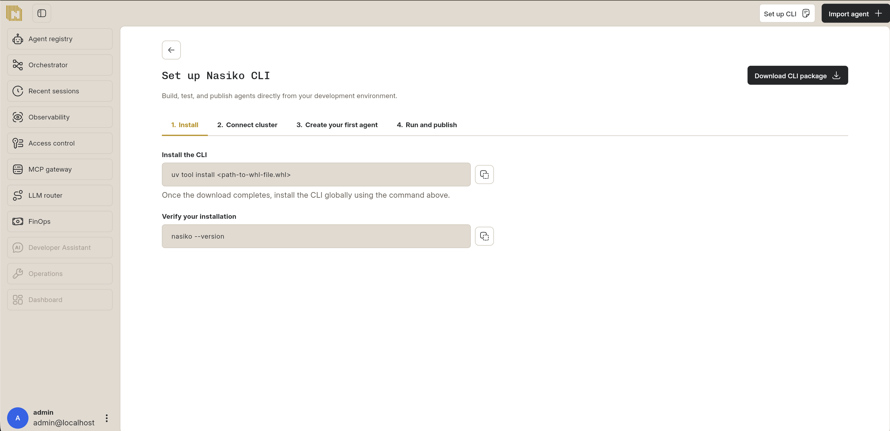
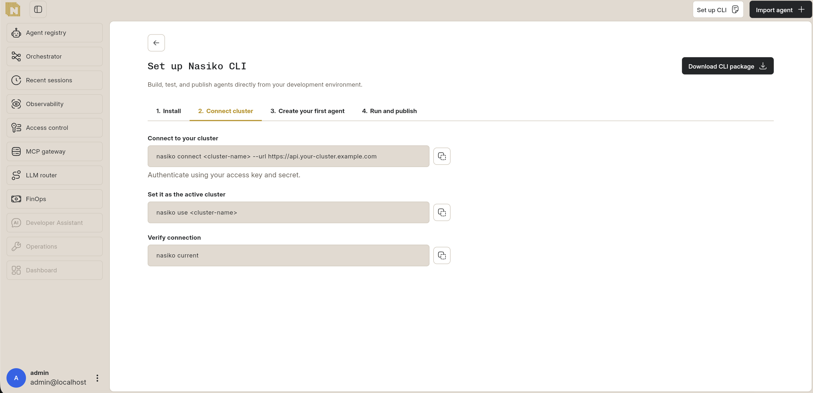
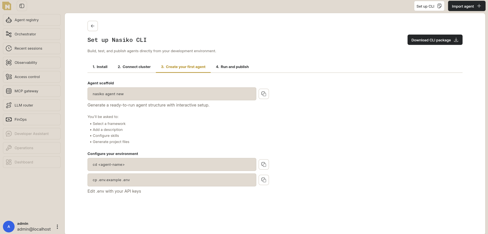
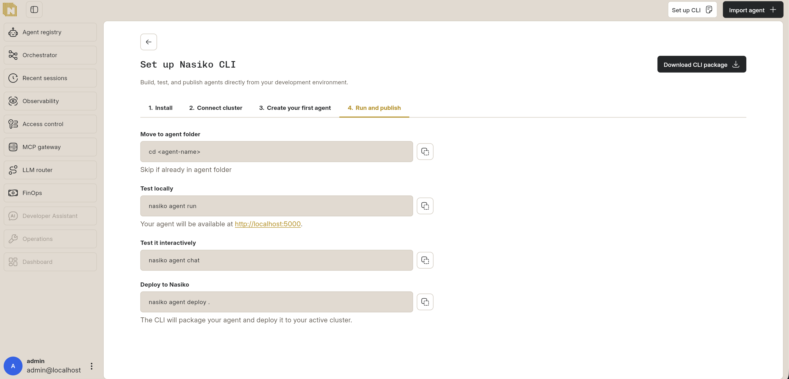

Nasiko ships two command-line tools, both standalone Rust binaries.

| CLI | Binary | For | Purpose |
| --- | --- | --- | --- |
| Developer | `nasiko` | Agent developers | Scaffold, build, deploy, and chat with agents |
| Platform admin | `nasiko-ee` | Administrators | Provision control planes, manage the org, grant agent access |

Building or deploying agents? Install `nasiko`. Provisioning a control plane or managing users, teams, and grants? Install `nasiko-ee`. Many administrators install both.

## Set up from the dashboard

**Set up CLI** in the dashboard header opens a four-tab walkthrough with a **Download CLI package** button and a copy button on every command.

<Steps>
  <Step title="Install">
    Download the package, then install it globally and check the version.

    <Frame>
      
    </Frame>
  </Step>
  <Step title="Connect cluster">
    Connect with your access key and secret, make it the active cluster, and verify.

    <Frame>
      
    </Frame>
  </Step>
  <Step title="Create your first agent">
    `nasiko agent new` scaffolds interactively — framework, description, skills, project files — then copy `.env.example` and fill in your API keys.

    <Frame>
      
    </Frame>
  </Step>
  <Step title="Run and publish">
    Run locally on port 5000, chat with it, then deploy to the active cluster.

    <Frame>
      
    </Frame>
  </Step>
</Steps>

## Developer CLI (`nasiko`)

```bash
git clone https://github.com/Nasiko-Labs/nasiko-rs.git
cd nasiko-rs
cargo install --path cli --force
nasiko --help
```

Installs to `~/.cargo/bin`. State lives in `~/.nasiko/config.json` (clusters, active cluster, tokens) and `~/.nasiko/.env` (local-stack config from `nasiko up`).

<Steps>
  <Step title="Point at a control plane">
    `nasiko up` connects itself automatically as cluster `local`. For an existing control plane:

    ```bash
    nasiko connect https://nasiko.example.com --name prod
    ```
  </Step>
  <Step title="Pick the active cluster">
    ```bash
    nasiko use prod
    nasiko clusters       # list registered clusters
    ```

    All commands operate against the active cluster.
  </Step>
  <Step title="Authenticate">
    ```bash
    nasiko auth login
    nasiko auth whoami
    nasiko auth status
    nasiko auth logout
    ```
  </Step>
</Steps>

## Troubleshooting `nasiko up`

Known gaps in the current build. Find your symptom, apply the workaround.

<AccordionGroup>
  <Accordion title="pull access denied for nasiko/cp">
    `nasiko up` pulls `nasiko/cp:latest` from Docker Hub to run the local control plane, and that
    image isn't publicly available yet. Build the control plane from source instead:

    ```bash
    cargo build --release -p nasiko-server
    mkdir -p ~/.nasiko/bin
    cp target/release/nasiko-server ~/.nasiko/bin/nasiko-cp
    ```

    `nasiko up` only pulls the image when `~/.nasiko/bin/nasiko-cp` doesn't already exist, so once
    it's there, `nasiko up` starts the infra containers and runs your build instead of pulling.
  </Accordion>

  <Accordion title="missing required env var: ADMIN_PASSWORD (or JWT_SECRET must be set)">
    The control plane requires `ADMIN_PASSWORD` and `JWT_SECRET` at startup — neither has a
    default, and `nasiko up` doesn't prompt for them or set them itself. Export them first:

    ```bash
    export ADMIN_PASSWORD=admin
    export JWT_SECRET=dev-secret-change-me
    nasiko up
    ```

    With `ADMIN_PASSWORD` set this way, the printed `nasiko auth login # admin / admin` hint is
    accurate — log in with whatever username/password you chose.
  </Accordion>

  <Accordion title="Control plane stops when you close the terminal">
    Unlike the Docker infrastructure (which runs detached), the control-plane process is a plain
    foreground child of the shell you ran `nasiko up` in — closing the window, an SSH disconnect,
    or a multiplexer pane closing all kill it. Keep that terminal open, or run it yourself as a
    background process:

    ```bash
    nohup ~/.nasiko/bin/nasiko-cp > /tmp/nasiko-cp.log 2>&1 &
    disown
    ```

    Use the same environment variables `nasiko up` would otherwise set — see its output for the
    full list.
  </Accordion>

  <Accordion title="Sessions show up, but traces, tokens, and cost stay empty">
    `nasiko up` doesn't set `TEMPO_URL` or `LOKI_URL`, so the control plane starts with
    observability disabled even though the same compose file already brings up Tempo and Loki
    containers. Set both before starting it to see trace and cost data in `nasiko observe`:

    ```bash
    export TEMPO_URL=http://localhost:3200
    export LOKI_URL=http://localhost:3100
    ```
  </Accordion>
</AccordionGroup>

## Platform admin CLI (`nasiko-ee`)

<Warning>
  **Enterprise feature.** Everything below this heading (install script, build-from-source
  variants, control-plane provisioning, registry activation) is `nasiko-ee` — the enterprise
  admin CLI. Not available in the open-source edition.
</Warning>

<Tabs>
  <Tab title="Install script">
    ```bash
    curl -fsSL https://get.nasiko.dev/ee | bash
    ```

    Anonymous download, no login. Installs to `~/.local/bin`, never uses `sudo`, never edits your shell rc files — it prints the `PATH` line to add.

    | Variable | Default | Purpose |
    | --- | --- | --- |
    | `NASIKO_EE_VERSION` | `latest` | Pin a version, e.g. `v0.1.0` |
    | `NASIKO_INSTALL_DIR` | `~/.local/bin` | Install destination |
    | `NASIKO_REGISTRY` | `registry.nasiko.dev` | Registry host, for mirrors or air-gapped installs |

    If piping `curl` into `bash` is disallowed at your organization, download and review the script first.
  </Tab>
  <Tab title="Build from source">
    Three variants, identical except for cluster provisioning:

    | Variant | Command | Binary | Provisioning commands |
    | --- | --- | --- | --- |
    | Default | `cargo install --path ee/cli --force` | `nasiko-ee` | Full |
    | Full, as `nasiko` | `just install-cli-enterprise` | `nasiko` | Full |
    | Lightweight | `just install-cli-enterprise-subset` | `nasiko` | Stubbed |

    The lightweight variant stubs `cluster create` and `init --agent-runtime kubernetes`; everything else behaves identically.

    <Warning>
      Installing under the `nasiko` name **replaces** the developer CLI in `~/.cargo/bin`. Switch back with `cargo install --path cli`.
    </Warning>
  </Tab>
</Tabs>

Verify with `nasiko-ee --version`.

### Provision a control plane

```bash
nasiko-ee init --setup
```

Creates `~/.nasiko/.ee.env` with a template for cloud credentials (AWS, DigitalOcean, Azure, or GCP), your Docker Hub org, and optional keys like `OPENAI_API_KEY`. Fill it in, then:

```bash
nasiko-ee init \
  --provider do \
  --region blr1 \
  --domain nasiko.example.com \
  --admin-password <password>
```

Next: [setting up an organization](/multi-tenant).

### Registry access

The control-plane image comes from a private registry. Save the read-only pull token Nasiko provides:

```bash
nasiko-ee activate <token>
```

Writes `~/.nasiko/registry-values.json`, which the cluster install commands use to authenticate pulls.
