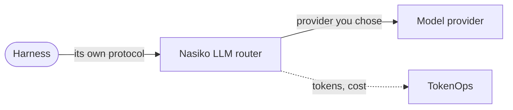

Harnesses arrive tied to a vendor: Claude Code to Anthropic, Codex to OpenAI. Routing gives that choice back to you. Register a provider and key once, then point the harness at your Nasiko cluster. The harness keeps speaking its own protocol; Nasiko selects the outbound provider.

Routing is available for Claude Code, Codex, and OpenCode. The Cursor CLI supports [session reporting](/coding-agents/session-reporting) only.

Routing and session reporting are independent. You can route without reporting, or report without routing. See [Coding agents](/coding-agents/overview).

## Connect a harness

```bash
nasiko llm-config create --name my-openai --provider openai --model gpt-4o \
  --api-key-secret OPENAI_API_KEY --secret-value "$OPENAI_API_KEY"
nasiko connect claude --config my-openai
nasiko status claude
```

`connect` needs an active cluster and a current login. It:

1. Reuses the coding-agent identity created by [registration](/coding-agents/discover#what-registration-creates), or registers one if you haven't installed reporting yet.
2. Attaches the LLM config you named with `--config`. Omit `--config` to use your default config, or `--agent` to reuse an existing coding-agent identity by name or UUID.
3. Writes the harness's own provider settings so new sessions call Nasiko instead of the vendor.

Inbound protocol and outbound provider are decoupled. `nasiko connect claude --config my-openai` sends Claude Code's Anthropic-format traffic to OpenAI.

<Warning>
  Claude Code's `~/.claude/settings.json` and OpenCode's config are per-user, global files. Connecting a harness affects every process of that harness on the machine, not just the current project.
</Warning>

## What changes on your machine

| Harness | Files written | How credentials are obtained |
| --- | --- | --- |
| Claude Code | `~/.claude/settings.json`: `apiKeyHelper` → `nasiko __claude-token`; `env.ANTHROPIC_BASE_URL` → your cluster URL | Claude Code runs the helper; Nasiko mints a one-hour JWT from `POST /api/agents/{id}/llm-token`. Claude Code sends it as `x-api-key`. |
| Codex | `$CODEX_HOME/config.toml` (or `~/.codex/config.toml`): `model_provider = "nasiko"` and `[model_providers.nasiko]` with `wire_api = "responses"` and `base_url = {cluster}/v1` | Command-based auth runs `nasiko __coding-agent-token codex`. Codex refreshes on a timer rather than minting a token per request. |
| OpenCode | `{opencode-config}/plugins/nasiko-llm-router.js`, plus a `nasiko` provider whose default model is `nasiko/router` | The plugin calls the same credential helper. Failures return an error to OpenCode; they never forge a token. |

Connection state is saved under `~/.nasiko/integrations/`:

| Path | Harness |
| --- | --- |
| `claude.json` | Claude Code |
| `codex-router.json` | Codex |
| `opencode-router.json` | OpenCode |

The `__claude-token` and `__coding-agent-token` helpers are internal. Don't call them yourself.

## How a call is routed



The harness talks to Nasiko at `/v1/messages` (Claude Code), `/v1/responses` (Codex), or the OpenCode plugin's equivalent. The router translates the inbound format, selects the model from the attached LLM config, and calls the provider. Spend is attributed to the coding-agent identity, so it shows up next to reported sessions in [TokenOps](/tokenops/dashboard).

If the config's `model` is unset, the router falls through the [model registry](/models/model-registry) tiers and then the cluster default.

## Failure behavior

Routing credentials **fail closed**. If Nasiko cannot issue a JWT — the cluster is unreachable, your login expired, `AGENT_JWT_SECRET` is unset on the server, or the helper times out — the harness gets an error. It never falls back to calling the vendor with the original key.

That is the opposite of [session reporting](/coding-agents/session-reporting), which fails open: turns queue locally and the harness keeps working.

Self-hosting: set `AGENT_JWT_SECRET` on the server or every routed call is rejected with `401`. See [Server configuration](/self-hosting/configuration).

## One-shot Claude Code

To run Claude Code through Nasiko for a single invocation, without changing `~/.claude/settings.json`:

```bash
nasiko claude --agent <name-or-uuid> --config my-openai -- <args passed to claude>
```

`--agent` is required. Everything after `--` is handed to the `claude` binary. Environment for that process is injected for the duration of the command.

## Disconnect

```bash
nasiko disconnect claude
nasiko disconnect codex --force
```

`disconnect` restores the harness settings Nasiko changed and deletes the local routing state file. It does **not** uninstall session reporting — use `nasiko agents uninstall <agent>` for that.

If the harness is still running, `disconnect` refuses unless you pass `--force`. Stop the harness first when you can, so it doesn't keep using a credential helper that is no longer installed.

## Check status

```bash
nasiko status              # cluster health
nasiko status claude       # routing binding for one harness
nasiko status codex
nasiko status opencode
```

Per-harness status shows whether routing is connected, which cluster and LLM config it uses, and the coding-agent identity.

For every flag, see the [coding agents CLI reference](/reference/cli/coding-agents). For LLM configs, see [LLM configs](/models/llm-configs).
