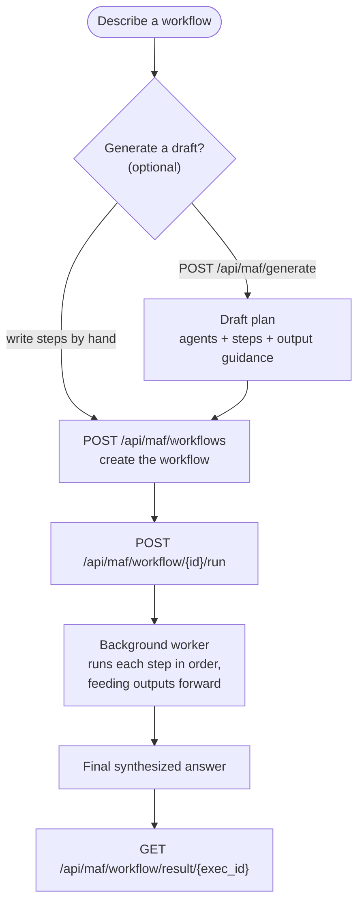

A routed chat request picks *one* agent to answer a query — see the [routing engine
guide](/guides/llm-router) for how that decision gets made. A **MAF (Multi-Agent Flow) workflow**
is different: it's a named, ordered sequence of steps, each bound to a specific agent, where each
step's output feeds the next and a final step synthesizes everything into one answer.

Reach for a workflow when a task genuinely needs several specialist agents chained together —
research, then analyze, then summarize — rather than a single best-match agent handling it end to
end.

<Warning>
  A MAF step calling its agent is a direct call to that agent's endpoint — it does **not** go
  through the same path as routed chat, so it isn't subject to the [flow guard](/platform/orchestrator#the-flow-guard)'s
  cascade limits (depth, fan-out, token budget, timeout, cycles) or to [agent-to-agent
  ACL](/guides/acl/overview) checks. A step can call any agent it's assigned, regardless of what an
  allowlist would otherwise permit. The workflow-authoring boundary — who can create a workflow and
  which agent ids they put in it — is the access control that applies here. See [MAF
  internals](/platform/maf#what-doesnt-apply-here-flow-guard-and-agent-acl) for the full detail.
</Warning>

## The model: define, generate, run



**Define a workflow** — `POST /api/maf/workflows` with a name, an optional description, and a list
of steps. Each step needs a task description and either an explicit agent, or nothing at all: steps
with no agent specified are auto-assigned via the routing engine at creation time. Manage workflows
with `GET /api/maf/workflows` (list yours), and `GET` / `PUT` / `DELETE /api/maf/workflow/{id}` to
read, edit, or remove one.

**Generate a draft from plain language** (optional) — `POST /api/maf/generate` takes a
natural-language description of what you want done, looks at the agents you have registered, and
returns a ready-to-review draft: a workflow name, description, output-synthesis guidance, and a step
list with agent assignments already filled in. Review and adjust it, then create it for real with
`POST /api/maf/workflows`. This requires an LLM to be configured on the control plane — it returns a
`503` if none is available.

**Run it** — `POST /api/maf/workflow/{id}/run` queues an execution and returns immediately with
`202 Accepted` and an `execution_id`; the workflow itself runs off the request path. Poll
`GET /api/maf/workflow/result/{exec_id}` (or `GET /api/maf/execution/{id}`) for status and the final
output. `GET /api/maf/workflow/{id}/executions` lists run history for one workflow;
`GET /api/maf/executions` lists every execution across all of your workflows — each entry carries
attempt/retry counts, tokens used, duration, and the per-step results.

## What a step carries

Each step you define names an agent and a short task description. At run time, the platform expands
that into an actual prompt — resolving placeholders from earlier steps' outputs — plus an
"extraction goal" describing what to pull out of that agent's reply. As execution proceeds, each
step's status moves `pending → running → success` (or `failed`), and the platform records token
usage and latency per step. A workflow also carries `output_generation` guidance: instructions for
how to turn all the step outputs into one coherent final answer.

## Reliability

Runs aren't executed inline on the HTTP request — they're queued and picked up by a background
worker, so a slow or multi-step workflow doesn't tie up a client connection. Failed steps retry
automatically up to a configurable attempt limit (`MAF_MAX_ATTEMPTS`, default `3`), and executions
that were in flight when a server restarts are picked back up rather than lost.

## Example

Create a two-step workflow — the first step names an agent explicitly, the second lets the routing
engine assign one automatically — then run it and fetch the result:

```sh
curl -X POST https://<control-plane>/api/maf/workflows \
  -H "Authorization: Bearer $TOKEN" -H "Content-Type: application/json" \
  -d '{
    "name": "research-and-summarize",
    "steps": [
      { "task_description": "Research recent news on topic X", "agent_id": "<research-agent-uuid>" },
      { "task_description": "Summarize the research into 3 bullet points" }
    ]
  }'
# -> { "data": { "id": "<workflow-id>", "name": "research-and-summarize", ... } }

curl -X POST https://<control-plane>/api/maf/workflow/<workflow-id>/run \
  -H "Authorization: Bearer $TOKEN"
# -> 202 { "execution_id": "<execution-id>", "execution_number": 1, "execution_count": 1 }

curl https://<control-plane>/api/maf/workflow/result/<execution-id> \
  -H "Authorization: Bearer $TOKEN"
# -> { "data": { "status": "success", "output": "...", "step_results": [ ... ] } }
```

<CardGroup cols={2}>
  <Card title="MAF reference" href="/platform/maf">
    Deeper platform-level reference for workflow execution.
  </Card>
  <Card title="Orchestrator reference" href="/platform/orchestrator">
    How the routing engine that auto-assigns steps works.
  </Card>
  <Card title="Core concepts" href="/guides/architecture/core-concepts">
    Sessions, traces, and the building blocks workflow executions plug into.
  </Card>
  <Card title="Agent Development Lifecycle" href="/guides/adlc/overview">
    Building and deploying the agents a workflow calls into.
  </Card>
</CardGroup>
