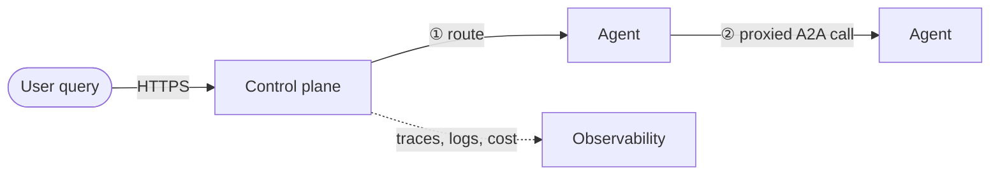

Nasiko is an **A2A (Agent-to-Agent) orchestration platform**. You build agents that speak the A2A
protocol, and Nasiko takes care of everything around them: deploying agent containers, routing a
user's query to the best agent for the job, proxying every agent-to-agent call, and giving you
end-to-end observability — traces, logs, and cost — across the whole interaction.

## The problem it solves

Once you have more than one or two agents, a few problems show up that have nothing to do with
the agents' own logic:

- **Which agent should handle this query?** Static routing rules don't scale past a handful of
  agents, and hardcoding "if X then agent Y" logic in every client is brittle.
- **Agents calling agents can spiral.** Without limits on call depth, fan-out, and token spend, a
  multi-agent conversation can cascade into a runaway loop or an unbounded bill.
- **Nobody can see what happened.** When agent A calls agent B calls agent C, and the answer comes
  back wrong (or slow, or expensive), you need one trace across all three hops — not three
  disconnected logs.
- **Access control gets bolted on late.** Who can call which agent, which users can manage
  secrets, which teams own which agents — these need to be first-class, not an afterthought.

Nasiko's control plane is a single server that sits in front of your agents and handles all of
this centrally: it is the sole ingress, agents are never exposed directly, and every agent-to-agent
call flows back through the same proxy — which is exactly what makes consistent routing, flow
limits, and observability possible in the first place.

## Who it's for

- **Agent developers** who want to scaffold, run, and deploy an A2A agent without writing
  deployment or observability plumbing themselves.
- **Platform administrators** who provision the control plane, manage departments/teams/users,
  and control which agents each part of the organization can reach.
- **End users** who just want to ask a question and get routed to the right agent, through a chat
  UI or the CLI.

## A tour of the platform

<CardGroup cols={2}>
  <Card title="Agent lifecycle" icon="rocket" href="/guides/adlc/overview">
    Scaffold an agent, run and chat with it locally, then deploy, version, and manage it on a
    cluster — the full Agent Development Lifecycle.
  </Card>
  <Card title="Routing" icon="route" href="/guides/llm-router">
    A three-stage routing engine (shortlist, rerank, select) picks the best agent for a query, with
    graceful fallbacks at every stage.
  </Card>
  <Card title="MCP tool access" icon="plug" href="/guides/mcp/overview">
    Connect agents to external MCP servers or deploy your own internal ones, with per-agent tool
    permissions.
  </Card>
  <Card title="Access control" icon="shield-check" href="/guides/acl/overview">
    User-to-agent grants and agent-to-agent allowlists, plus an org hierarchy of departments,
    teams, and roles for larger organizations.
  </Card>
  <Card title="Secrets" icon="key" href="/guides/secrets/overview">
    Encrypted-at-rest secrets, injected into agent containers at deploy time — never stored in
    plaintext, never baked into images.
  </Card>
  <Card title="Observability" icon="chart-line" href="/platform/observability">
    Every multi-agent interaction is a single trace across hops, with token usage, cost, and logs
    attached — with zero code changes in the agent.
  </Card>
  <Card title="Artifact registry" icon="box-archive" href="/guides/artifact-registry">
    A registry for agent images, skills, and templates, alongside the embedded OCI registry that
    stores your deployed agent images.
  </Card>
  <Card title="Multi-agent flows" icon="diagram-project" href="/guides/maf">
    Compose multiple agents into a single planned, executed workflow instead of one-shot routing.
  </Card>
</CardGroup>

## How a request flows

A user sends a query to the control plane. Nasiko picks an agent for it (or the query names one
directly). If that agent needs to call another agent to finish the job, the call is proxied
back through the control plane — never agent-to-agent directly — so flow limits and tracing apply
uniformly, no matter how deep the call chain gets.

## Where to go next

- New to Nasiko? Start with the [quickstart](/guides/quickstart/overview) to get a control plane
  running and chat with your first agent in minutes.
- Setting up for a team or organization? See
  [setting up an organization](/guides/quickstart/multi-tenant-creation).
- Want the system-level picture — components, request flow, data stores? Read
  [architecture overview](/guides/architecture/overview) and
  [core concepts](/guides/architecture/core-concepts).
