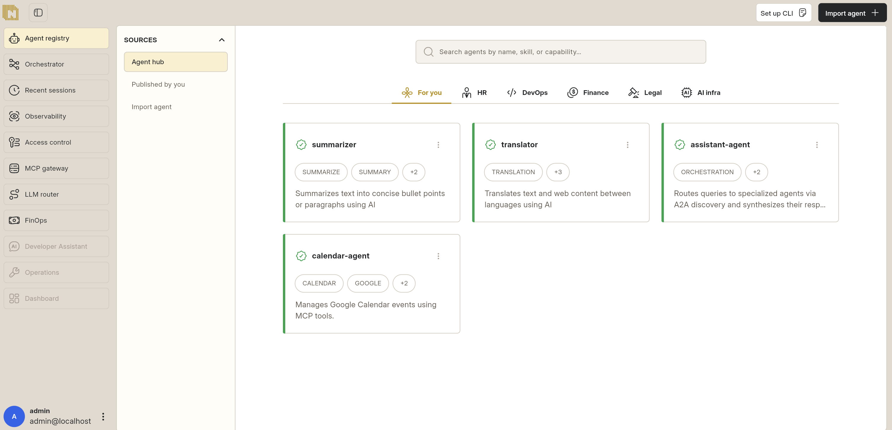
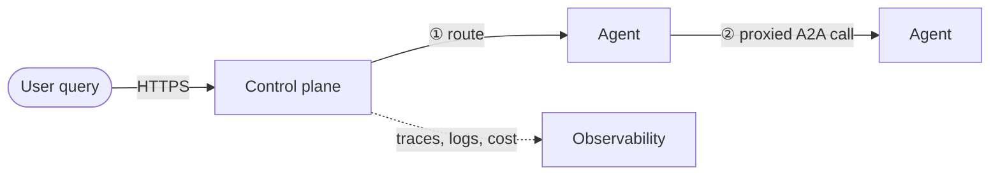

Nasiko is the control plane for enterprise AI agents. One place to register every agent your organization runs, control what it can access, route traffic to it, and see what it costs.

<CardGroup cols={1}>
  <Card title="TokenOps" icon="coins" horizontal>
    Track and control AI spend.
  </Card>
  <Card title="Policy, security & governance" icon="shield-check" horizontal>
    Control what agents can access and do.
  </Card>
  <Card title="Multi-agent harness" icon="diagram-project" horizontal>
    Run workflows across models, tools, and frameworks.
  </Card>
</CardGroup>

{/*
<Frame>
  
</Frame>
*/}

## How a request flows

Nasiko routes the query to an agent, or uses the one you name. Agent-to-agent calls are proxied back through the control plane — never direct — so flow limits and tracing apply at every hop.

## Start here

<CardGroup cols={2}>
  <Card title="Quickstart" icon="rocket" href="/quickstart">
    Deploy an agent and chat with it.
  </Card>
  <Card title="Agent lifecycle" icon="cube" href="/adlc/overview">
    Scaffold, run, deploy, and version agents.
  </Card>
  <Card title="Routing" icon="route" href="/platform/llm-router">
    Shortlist, rerank, select the right agent.
  </Card>
  <Card title="MCP tool access" icon="plug" href="/mcp-hub/overview">
    Connect agents to external or internal MCP servers.
  </Card>
  <Card title="Access control" icon="shield-check" href="/onboarding/acl/overview">
    Grant users and agents access to agents.
  </Card>
  <Card title="Secrets" icon="key" href="/platform/secret-manager/overview">
    Inject encrypted secrets at deploy time.
  </Card>
  <Card title="Observability" icon="chart-line" href="/product/observability">
    One trace per interaction, with cost attached.
  </Card>
  <Card title="TokenOps" icon="coins" href="/platform/tokenops">
    Spend per agent and per model.
  </Card>
  <Card title="Artifact registry" icon="box-archive" href="/artifact-registry/overview">
    Agent images, skills, and templates.
  </Card>
  <Card title="Multi-agent flows" icon="diagram-project" href="/platform/maf">
    Compose agents into one workflow.
  </Card>
  <Card title="Dashboard" icon="window" href="/product/overview">
    Chat, agents, cost, and admin screens.
  </Card>
</CardGroup>
