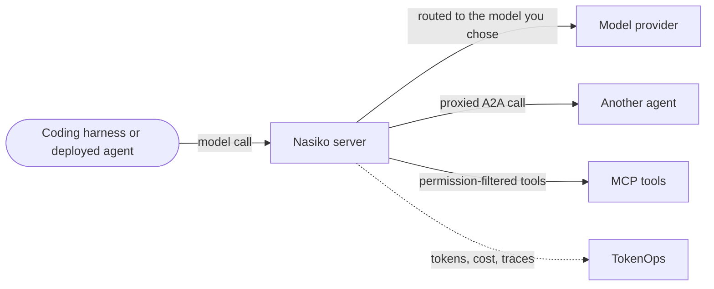

**Use any harness. Reach any model. Measure every token. Change nothing.**

Find the coding agents already running. See what each one costs, by harness, model and team. Reach any model from any harness. One command on a laptop, the same command across an estate — and nothing changes about how anyone works.

An OpenRuntime belongs to no vendor in it. Use any harness, any model, any framework, and change your mind about all three. Your cost history, policy and memory stay with you rather than with whichever tool you happened to pick.

## Two properties

<CardGroup cols={2}>
  <Card title="Non-invasive" icon="puzzle-piece">
    Your architecture. Nasiko discovers the harness you already run, and it keeps running unchanged. No wrapper. No SDK in your code path.
  </Card>
  <Card title="Non-intrusive" icon="hand">
    Your day. One command to find your agents, one more to register each, and your workflow stays the same. Developers keep using the same harness commands and interfaces.
  </Card>
</CardGroup>

## Choose your path

<CardGroup cols={2}>
  <Card title="Find and measure your coding agents" icon="magnifying-glass" href="/quickstart">
    Discover Claude Code, Codex, OpenCode and the Cursor CLI on your machine, report their sessions, and see what each one costs. About ten minutes.
  </Card>
  <Card title="Deploy an agent" icon="rocket" href="/quickstart-deploy">
    Scaffold an agent in any framework, run it locally, deploy it to your Nasiko cluster, and chat with it.
  </Card>
</CardGroup>

## What Nasiko does

<CardGroup cols={1}>
  <Card title="TokenOps" icon="coins" href="/tokenops/dashboard" horizontal>
    Spend across every harness and framework in one schema — by model, agent, session, developer and team.
  </Card>
  <Card title="Policy, security and governance" icon="shield-check" href="/governance/access-control/overview" horizontal>
    Control what each agent can reach, enforced where the call happens: access grants, tool permissions, approvals, flow limits and secrets.
  </Card>
  <Card title="Orchestration" icon="diagram-project" href="/build/overview" horizontal>
    Build, deploy and compose agents from any framework, and route each model call to the provider you choose.
  </Card>
</CardGroup>

## How a call flows

Nasiko sits in the call path. That's what lets it attribute cost across vendors and enforce policy without owning the machine.

A few terms you'll see throughout the docs:

- **Coding agent** or **harness**: a developer tool such as Claude Code, Codex, OpenCode or the Cursor CLI. Nasiko discovers it and can report its sessions and route its model calls. The harness itself is unchanged.
- **Deployed agent**: an agent you build in any framework and run on your Nasiko cluster. It speaks the A2A protocol.
- **Cluster**: a Nasiko server the CLI is connected to — local on your laptop, or shared across your organization.
- **Session**: one conversation, whether it came from a harness, the dashboard, or the CLI.
- **Flow**: everything one request caused — every agent hop, model call and tool call — traced and attributed together.

## Explore

<CardGroup cols={3}>
  <Card title="Coding agents" icon="terminal" href="/coding-agents/overview">
    Discovery, session reporting and model routing.
  </Card>
  <Card title="Model routing" icon="route" href="/models/llm-router">
    Route any harness or agent to any provider.
  </Card>
  <Card title="MCP gateway" icon="plug" href="/build/mcp/overview">
    One permission-filtered tool surface for every agent.
  </Card>
  <Card title="Dashboard" icon="window" href="/dashboard/overview">
    Every screen, explained.
  </Card>
  <Card title="Self-hosting" icon="server" href="/self-hosting/deploy">
    Run the full stack with Docker Compose.
  </Card>
  <Card title="CLI reference" icon="square-terminal" href="/reference/cli/overview">
    Every command and flag.
  </Card>
</CardGroup>
