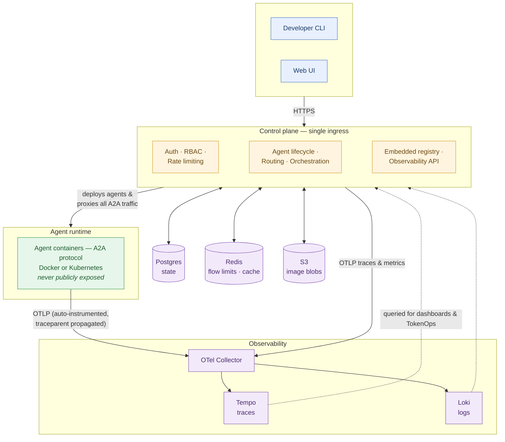
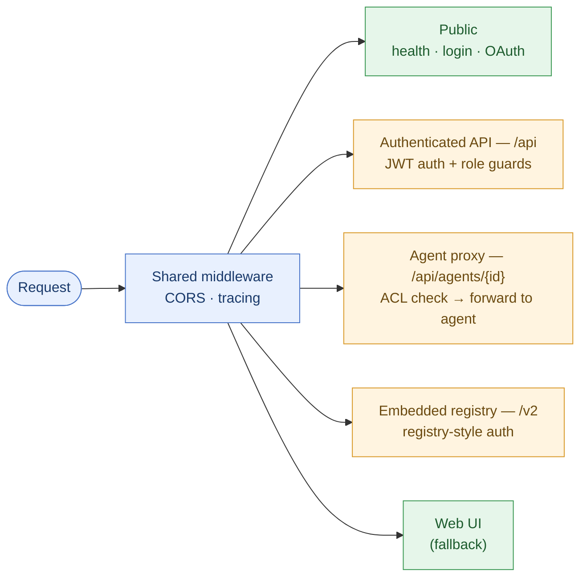

Nasiko is an A2A (agent-to-agent) orchestration platform. A single control plane deploys agent
containers, routes user queries to the best agent for the job, proxies all agent-to-agent traffic,
and gives you end-to-end observability — traces, logs, and cost (TokenOps) data — across every hop.

This page is a tour of the moving parts. For definitions of the terms used here (session, flow,
routing engine, and so on), see [core concepts](core-concepts.md).

## The big picture

Everything runs behind **one control plane**. There's no separate gateway in front of it — the
control plane terminates client traffic, enforces auth and rate limits, and forwards requests to
the right place, including into your agent containers.

Three properties fall out of this design:

- **The control plane is the sole ingress.** Agent containers are never exposed to the public
  internet — every agent-to-agent call flows back through the control plane, which is the one
  place flow limits and observability get enforced consistently.
- **State is durable and centralized.** Postgres holds platform state (agents, users, access
  grants, sessions), Redis backs flow limits and caching, and S3 stores agent image layers. The one
  exception: in-progress registry uploads (chunked blob buffers) are held in memory on whichever
  control-plane instance received them, so a single image push is sticky to that instance until it
  completes.
- **Telemetry is automatic.** The control plane injects OpenTelemetry configuration into every
  agent deployment, so traces and logs flow to the collector without any code changes in your
  agent — then the control plane queries that same data back out for dashboards and TokenOps
  reporting.

## Request flow

There's no gateway process — the control plane server binary owns the full middleware stack for
every incoming request: CORS, tracing, authentication, role-based access checks, and per-identity
rate limiting all run before a request is dispatched to its destination.

*Green surfaces are public; amber surfaces require credentials.*

A request lands in one of five places:

| Surface | Path | Who can reach it |
| --- | --- | --- |
| Public endpoints | `/health`, login, OAuth callbacks | Anyone |
| Authenticated API | `/api/*` | Signed-in users, gated by role |
| Agent proxy | `/api/agents/{id}/*` | Callers with access to that agent |
| Embedded registry | `/v2/*` | Registry-style credentials (see below) |
| Web UI | Everything else | Served as the fallback route |

<Note>
  Rate limiting is fixed-window, per identity, per endpoint group: A2A dispatch is limited to 30
  requests/minute, login to 30/minute, and registry traffic to 300/minute.
</Note>

### Registry authentication

The embedded container registry at `/v2/*` (used by `docker push`, BuildKit, and containerd) can't
carry a normal session token, so it accepts credentials in three forms:

1. A shared build-push credential for automated build pipelines
2. A per-agent pull credential, scoped read-only to that agent's image
3. A normal session token (bearer JWT or cookie), for interactive use

Every unauthenticated request to the registry gets a `WWW-Authenticate` challenge, which is what
tells registry clients to retry with credentials.

## Agent containers

Agents speak the A2A protocol and run as containers behind the
control plane. Nasiko can run them two ways:

<CardGroup cols={2}>
  <Card title="Docker" icon="docker">
    Single node, one replica per agent. The control plane talks to the agent directly at its
    container endpoint. Good for local development and single-machine deployments.
  </Card>
  <Card title="Kubernetes" icon="circle-nodes">
    Scaled, multi-node. Agents run as Deployments with Services in front of them, autoscale with
    load, and build through an in-cluster pipeline. Good for production fleets.
  </Card>
</CardGroup>

Whichever runtime you use, the contract is the same from the control plane's point of view: deploy,
scale, restart, fetch logs, and route traffic to an endpoint. Agents are never given a public IP or
DNS name — the only way to reach one is through the control plane's proxy, which checks
[access control](acl-internals.md) before every call and enforces [flow guard](core-concepts.md)
limits on every inter-agent hop.

## Where to go next

- [Core concepts](core-concepts.md)
- [Orchestrator internals](orchestrator-internals.md)
- [ACL internals](acl-internals.md)
- [Observability internals](observability-internals.md)
