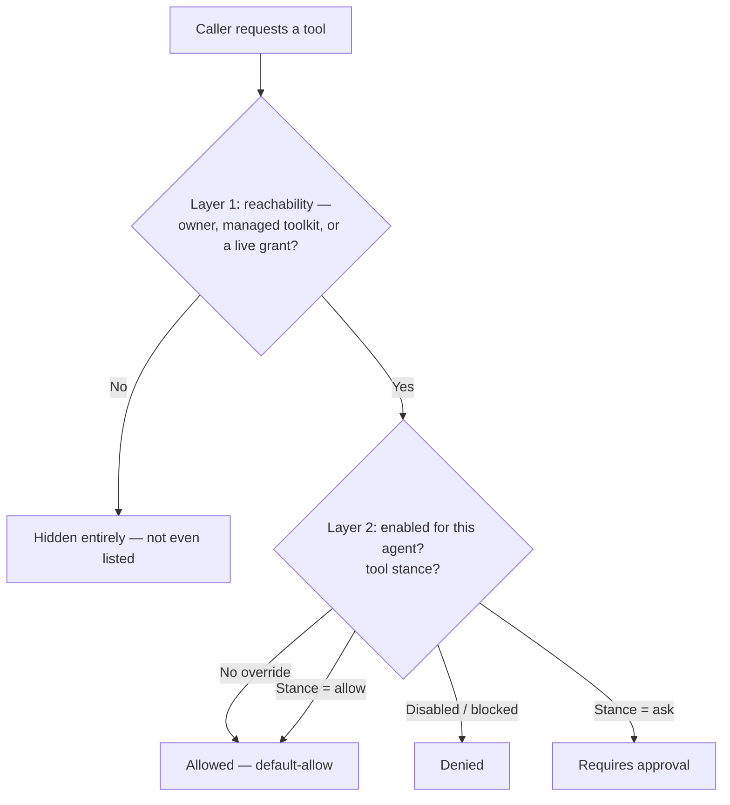

# MCP gateway internals

**Internal only.** Absorbed the whole of `platform/mcp-gateway.mdx`, which was removed from
the published site — "MCP gateway reference" was judged too implementation-level for
customers. There is no longer a customer-facing MCP gateway *reference* page.

What survives publicly:

- `mcp-hub/overview.mdx` — the delegation-token model, the two permission layers stated
  behaviorally, the agent-facing `POST /api/mcp` route, and the management route table
  relocated there because customers integrate against it.
- `mcp-hub/internal-mcp-deployment.mdx` — the hardened build-and-deploy sequence, the
  readiness handshake, and self-heal, all as behavior.
- `onboarding/acl/user-agent-mcp.mdx` — the allow/ask/block rules Layer 2 enforces.

## Permission resolution order

## Readiness gate on an uploaded server

After a hardened deploy, the gateway polls `tools/list` against the new container for up to
roughly ninety seconds before marking the connector `running` and syncing its tool catalog.
If readiness never succeeds the container is torn down rather than left unreachable, so a
failed build never leaves an orphaned workload behind.

Uploads ride the same background build pipeline as agent source uploads — see
`agent-runtime-internals.md` for the retry cap and stuck-job recovery that path inherits.

## Delegation token — why it's minted and validated in one process

The actor-pattern JWT binds two identities (`sub = user_id`, `act = agent_id`,
`aud = "mcp"`) with a short expiry, minted by the same server process that forwards a
user's request to an agent container. Two properties follow from not splitting that across
a network hop:

- **Stateless.** No database write per request to mint or validate — cost doesn't scale
  with traffic.
- **No second interpreter.** Signature, audience, and expiry are checked in the same
  middleware that resolves identity from the claims; there is no separate service that
  could parse the token's meaning differently.

`POST /api/mcp` is deliberately not behind the normal session-JWT middleware. An agent
structurally cannot hold a session credential anyway — the agent-proxy module strips
`Authorization` and `Cookie` before a request reaches a container.

## Cache-key construction

All caching is Redis-backed (shared across replicas; this is a horizontally scaled
service, so an in-process cache would be inconsistent between them).

The merged tool manifest is cached under a key built from **both**:

1. the caller's current connector set, and
2. a **permission hash** — a deterministic digest of every active rule and
   disabled-connector flag for that `(user, agent)` pair.

Either component changing produces a different hash, and the hash is itself part of the
cache key. A permission edit is therefore visible on the very next call with **no separate
invalidation step** — there is nothing to forget to invalidate. This is the design detail
to preserve if the caching layer is ever reworked.

## Layer ordering is security-critical

Layer 1 (reachability) must be re-confirmed on every check, never assumed from a prior
pass. A revoked grant that left a stale permissive Layer 2 row behind must not continue to
let someone in. This is why revoking a share deletes the grantee's stored connection
credential **in the same transaction** as the grant row — a later re-grant can never
silently reactivate an old session.

Layer 2 is **default-allow, not default-insert**: nowhere does "no row" mean "no access."
A missing override for a `(user, agent, connector)` triple means fully allowed; a row only
ever exists to restrict. This is what makes sharing take effect on every one of the
grantee's agents immediately with zero rows written at share time.

Both layers are re-checked in full at `tools/call` time, not only at `tools/list` time,
closing the window where a tool is listed and then blocked a moment before invocation.

## The `trusted` flag and the SSRF client split

Two HTTP clients exist:

- **Guarded client** — every user-supplied MCP server URL. Its DNS resolver rejects
  loopback, private, link-local, and cloud-metadata addresses, both at registration and
  again at the moment of each connection. Resolving and connecting through the same guarded
  path in one step is what closes the DNS-rebinding gap; checking only at registration
  would leave it open.
- **Unguarded client** — used *only* for `MCPServerConfig`s whose `trusted` flag is `true`.

`trusted` is computed in **exactly one place**, derived from the connector's own
`source_kind` column, and is never accepted as input from a request body, a CLI flag, or
anywhere else external. An uploaded server's address was resolved by the platform's own
runtime after building and deploying it — necessarily internal, which is precisely what
the guard exists to reject for user-supplied input.

> If `trusted` ever becomes settable from outside that one derivation, the SSRF guard is
> fully bypassable. Treat it as a security invariant, not a config field.

## `EndpointRefresher`

A seam for self-healing a stale uploaded-connector address: on a failed call, re-resolve
the connector's current address from the runtime and retry once. On demand only, after a
real failure — never a background poll.

## Known gap: the per-connector secret token is not verified

A per-connector secret token is generated once and injected into an uploaded container's
environment. The uploaded server *may* optionally read it and echo it back on inbound
calls.

**The platform does not currently require or verify that it comes back.** This is
deliberately deferred defense-in-depth, not a load-bearing check. It is not mentioned on
the customer-facing page, which describes only the controls that are actually enforced
(non-root uid, read-only rootfs, dropped capabilities, no-new-privileges, network
segmentation, readiness handshake).

## Docker vs. Kubernetes hardening

The OS-level hardening applied to uploaded MCP servers matters specifically under the
**Docker** runtime. Kubernetes already hardens every pod this way, so the setting is a
no-op there. Under Kubernetes, namespace isolation plus a tighter `NetworkPolicy` variant
applies instead — an MCP connector never needs an outbound path back to the control plane
for A2A traffic, unlike an agent, so it doesn't get one.
