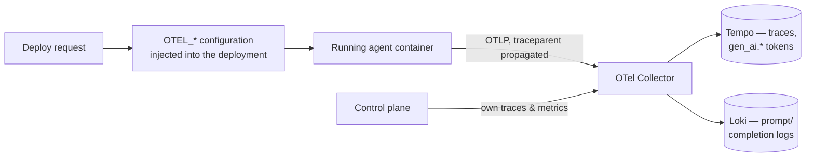

# Observability internals

**Internal only.** Absorbed the whole of `platform/observability.mdx`, which was removed
from the published site — "Observability reference" was judged too implementation-level for
customers. There is no longer a customer-facing observability *reference* page.

What survives publicly:

- `product/observability.mdx` — the Sessions / Session Trace / Flows screens, the
  session/trace/flow vocabulary table, plus the `/api/observability/*` route table and the
  `OTEL_*` / `TEMPO_URL` / `LOKI_URL` configuration table, both relocated there because
  self-hosting operators and API integrators need them (see the README's
  "what deliberately stayed customer-facing").
- `product/tokenops.mdx` — cost behavior, stated as behavior only.

## Pipeline shape

Every agent exports OTLP to a collector, which fans out to **Tempo** (traces, with
`gen_ai.*` attributes on every LLM-call span) and **Loki** (prompt and completion log
lines). The control plane exports its own traces and metrics down the same path — routing
decisions, proxy hops, and request handling land in the same Tempo instance agents use.

## `InstrumentedRuntime<R>`

A wrapper around the `ContainerRuntime` trait. Every deployment passes through it before
reaching Docker or Kubernetes, and it injects OpenTelemetry configuration into the
deployment spec: OTLP endpoint, protocol, headers, and sample ratio all become environment
variables on the container, sourced from the control plane's own `OTEL_*` configuration.

Applied uniformly — an agent cannot opt out, and no agent-side code enables it.

## The Python `sitecustomize.py` injection

For Python agents specifically, the injector patches the agent's Dockerfile to install a
`sitecustomize.py` into the image. Python imports `sitecustomize` automatically before any
of the agent's own code runs, which is the mechanism that makes zero-source-change
instrumentation possible. It:

- initializes the OpenTelemetry SDK from the injected env vars, so the agent exports OTLP
  the moment it boots
- reads the inbound `traceparent` header and propagates it, so a hop to another agent (or
  to the LLM) shares the trace of the request that triggered it
- wraps `AgentExecutor.execute()` in a span carrying `session.id` — the single attribute
  that ties a conversation's separate traces back together
- instruments outbound OpenAI calls so `gen_ai.*` attributes land on the span

**Shadowing hazard.** Some Python web-server frameworks prepend their own
`sitecustomize.py` to `PYTHONPATH`, which would otherwise shadow the injected one and
silently disable all of the above. The injector accounts for that case specifically rather
than assuming a bare Python runtime. This is the failure mode to check first when a Python
agent reports no traces at all.

The customer-facing page states only the outcome — Python agents are instrumented with no
source changes, including under frameworks that manipulate `PYTHONPATH`.

## Read path: the `ObservabilityProvider` trait

Every dashboard route is backed by one trait, implemented by `TempoLokiProvider` (an HTTP
client pair over Tempo's and Loki's query APIs):

| Method | Backs |
| --- | --- |
| `sessions_for_agent` | Session list for one agent — groups traces by `session.id`, skipping traces that never got one (infrastructure noise) |
| `get_session` | Full drill-down: one trace summary per query in that conversation |
| `get_trace` | One full trace, every span, for one query |
| `get_span` | A single span's detail within a trace |
| `agent_stats` | Aggregate call/latency/success stats for one agent |
| `agent_finops` | Aggregate cost data for one agent |
| `count_user_traces` | Trace volume for a user, used by usage/quota views |
| `query_logs` | Loki log lines for an agent |
| `cost` | Token-usage-to-dollar conversion via `DbPricing` |

**Extension seam.** This is where the platform layers organization-scoped observability
(restricting which agents' sessions a viewer can see) without forking the Tempo/Loki query
logic. Roadmap intent — not customer-facing.

## `DbPricing`

Applies `gen_ai.usage.*` token counts against the `model_pricing` table. Each model has
`input_price_per_1m` / `output_price_per_1m`, versioned by an
`effective_from` / `effective_until` window so a price change doesn't retroactively re-cost
historical spend.

Lookups are cached in memory for five minutes. A model with no matching row falls back to a
**static built-in price table** rather than silently reporting zero cost — the
customer-visible consequence (an unknown model still shows a cost, not `$0.00`) is stated
publicly; the table name and the in-memory cache TTL are not.

## Session vs. trace vs. flow

Three granularities of the same conversation:

- **Session** — one end-to-end user query, identified by the A2A `contextId`.
- **Trace** — every hop answering that query, linked because each propagates the same W3C
  `traceparent`. A multi-agent interaction is one trace, not one per agent.
- **Flow** — the flow guard's view of the same `traceparent`-linked chain, used to enforce
  cascade limits rather than to display data. A flow and a trace are keyed by the same id;
  they are two consumers of it.

A MAF step derives its `traceparent` deterministically from the execution id and step index
via **UUIDv5**, so each step lands under its own distinct trace even though the execution
shares one MAF execution id.
