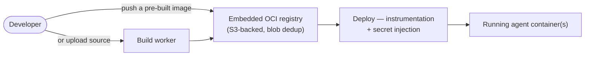

The [agent development lifecycle guide](/guides/adlc/overview) walks through building, deploying,
and iterating on an agent from the outside. This page covers the deployment abstraction underneath
that — the trait every runtime implements, how the two runtimes differ, and the background worker
that turns an uploaded source archive into a running container without ever tying up an HTTP
request while it does.

## The `ContainerRuntime` trait

Every deployment operation — regardless of which runtime is active — goes through one trait:

| Method | Behavior |
| --- | --- |
| `deploy` | Create or update a deployment from a spec. A no-op if the image is unchanged; an atomic replace if it changed. Returns the observed status immediately — on Kubernetes the pod may still be `Pending`, so a caller that needs `Running` polls `status` separately. |
| `destroy` | Remove all resources for a container id. Idempotent — a no-op if nothing exists. |
| `scale` | Set replica count. `0` stops the agent; Docker clamps anything above `1` down to `1` with a warning, since Docker has no native multi-replica concept. |
| `restart` | Docker stops and recreates the container from the same image; Kubernetes triggers a rollout restart. Either way, this is how a running agent picks up newly rotated secrets. |
| `status` / `list` | Observed state. A missing resource reports `Unknown` rather than erroring, so callers can poll without special-casing "not found yet." |
| `endpoint` | Resolves where to actually reach the running agent — `localhost:port` under Docker, a Service DNS name under Kubernetes. |
| `logs` | Container stdout/stderr, with a tail option. |
| `build` | Builds an image from a source tarball (used by the build worker below). |
| `refresh_secrets` | Re-injects a container's decrypted secrets, run before a scale-up so new replicas never start with stale credentials. |
| `try_delete_autoscaler` | Removes the runtime's autoscaling resource (a KEDA `ScaledObject` under Kubernetes) if one exists, best-effort. |

Two implementations exist behind this trait, selected by `AGENT_RUNTIME`:

<CardGroup cols={2}>
  <Card title="Docker" icon="docker">
    Single-replica, backed by bollard. `endpoint()` resolves to `localhost:port` on the host running
    the control plane. Straightforward, no cluster to operate — the right choice for local
    development and single-machine deployments.
  </Card>
  <Card title="Kubernetes" icon="circle-nodes">
    Deployments + Services, `endpoint()` resolves to the Service's cluster DNS name. Autoscaling is
    KEDA-driven (min/max replica annotations on the Deployment), secrets are refreshed before any
    scale-up, and builds run through an in-cluster pipeline described below.
  </Card>
</CardGroup>

Both runtimes are wrapped in `InstrumentedRuntime` before anything else touches them — it injects
OpenTelemetry configuration into every deployment spec, so instrumentation is applied uniformly
regardless of which runtime is active. See [observability](/platform/observability) for what that
injection actually does.

<Note>
  Agent secrets are stored AES-256-GCM encrypted at rest and only decrypted into a container's
  environment at deploy time — the plaintext never touches disk anywhere except inside the running
  container's own memory.
</Note>

## Two on-ramps, one deployment path

An agent's image gets onto the platform one of two ways:

- **Push a pre-built image** — `nasiko push` / `nasiko deploy` build locally and push layers plus a
  manifest straight to the platform's embedded `/v2/*` OCI registry (S3-backed, with blob dedup
  across layers), then request a deployment.
- **Upload source** — `nasiko upload` (or `POST /api/agents/upload`) ships a source archive, and the
  platform builds the image for you server-side, off the request path.

Either on-ramp lands in the same place: once the image is in the registry, deploying it wires up
networking, decrypts and injects secrets, and instruments it for observability — none of which
requires any change to the agent's own code.

## The build worker

Server-side builds don't run inline on the upload request — they're queued as rows in a
`build_jobs` table and picked up by a background worker, spawned once at server startup. The worker
polls the queue every five seconds (or wakes immediately on an in-process notification when a job
is queued), and every job it processes targets exactly one of an agent or an MCP connector build,
never both.

**Claim and execute are deliberately split into two phases.** Claiming a job — marking it
`in_progress`, incrementing its attempt counter — happens inline in the worker's own loop, since
that's pure database I/O with essentially no panic risk. Actually *running* the build (extracting
source, invoking `ContainerRuntime::build`, deploying, waiting for readiness) happens in a
separately spawned task, so a panic during the build itself can't take the whole worker loop down
with it — the outer loop catches the panicked task's join result and resets that one job, while
every other queued job is unaffected.

**Retries are capped at three attempts.** A job that exceeds `MAX_ATTEMPTS` is marked `failed`
immediately rather than retried again — including when the *claim itself* would push the attempt
counter past the limit, so an already-exhausted job never gets a wasted extra try.

**A periodic sweep recovers stuck jobs.** Every ten minutes (in addition to running once at
startup), the worker looks for jobs still marked `in_progress` after an hour — long enough that a
legitimately slow build wouldn't trigger it, but short enough to catch a job orphaned by a crashed
replica with no restart to reset it. Jobs found that have already exhausted their attempts are
marked permanently `failed` (so anything waiting on a status poll or stream stops waiting rather
than hanging forever); everything else is reset to `pending` for another try.

<Warning>
  A panicked build task is reset **immediately**, not left for the ten-minute sweep — the sweep
  exists specifically for the case a panic-catch can't cover: an entire replica dying mid-build with
  no chance to run its own recovery logic.
</Warning>

## Related

<CardGroup cols={2}>
  <Card title="Agent Development Lifecycle" href="/guides/adlc/overview">
    The end-to-end guide: scaffolding, running locally, deploying, and managing versions.
  </Card>
  <Card title="Observability internals" href="/platform/observability">
    What `InstrumentedRuntime` actually injects into a deployment.
  </Card>
  <Card title="MCP gateway internals" href="/platform/mcp-gateway">
    A second, more locked-down use of the same build worker — building uploaded MCP servers.
  </Card>
  <Card title="Access control internals" href="/platform/acl">
    Who can deploy, update, or manage a given agent once it's running.
  </Card>
</CardGroup>
