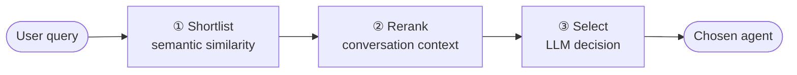

Nasiko's routing engine is a three-stage pipeline that picks one agent out of a candidate set. This
guide covers how that pipeline works, the configuration knobs you can tune, how to inspect the
decisions it makes — and, importantly, exactly where in the platform it actually runs today, since
that's easy to get wrong.

The routing engine is not an agentic loop — it makes one decision (which agent should answer this
query), then hands off. If you need several agents to collaborate on one task, see [Multi-agent
workflows](/platform/maf) instead.

## When routing runs

<Warning>
  If you're picturing this pipeline running on every chat message that doesn't name an agent —
  it doesn't, not directly. Read this section before assuming what powers your unrouted chat
  traffic.
</Warning>

Every chat request goes through `POST /api/orchestrator/a2a` (a JSON-RPC `message/send` or
`message/stream` call). What happens next depends on the request's `agent_id` metadata:

- **An explicit `agent_id`** — the request proxies straight to that agent's container. No selection
  happens at all.
- **No `agent_id`, or `agent_id: "orchestrator"`** — a multi-turn **orchestrator** runs instead, not
  the pipeline below. It exposes every agent you can access as a callable tool and lets an LLM
  decide — across as many as ten turns — which one (or several) to call. See [how Nasiko dispatches
  to agents](/adlc/a2a-agents#how-nasiko-dispatches-to-agents) for that mechanism;
  no shortlist or rerank step happens there.

The three-stage pipeline documented below is invoked directly in one place today: **auto-assigning
an agent to a [MAF workflow](/platform/maf) step** that doesn't name one explicitly. If you're tuning
or inspecting this pipeline, keep that scope in mind — it shapes MAF step assignment, not live chat
routing. See [where the pipeline actually runs](/platform/orchestrator#where-the-pipeline-actually-runs)
for the full detail, including its own fallback if the engine errors.

## The three-stage pipeline



1. **Shortlist** — ranks your deployed agents by semantic similarity between the query and each
   agent's description, keeping only the top candidates. This stage is skipped outright for small
   fleets (see `ROUTER_SHORTLIST_THRESHOLD` below) or if the embedding provider is unavailable — in
   either case every agent becomes a candidate for the next stage.
2. **Rerank** — re-scores the shortlisted candidates using the conversation's context (so a
   follow-up question is more likely to stay with the agent that's already handling the session).
   If reranking fails, the original shortlist order is kept unchanged.
3. **Select** — an LLM makes the final call among the reranked candidates. If the LLM call fails,
   the top-ranked candidate is chosen automatically and the decision is marked
   `fallback_used: true`.

Every stage is designed to degrade gracefully rather than fail the request — a query is never
rejected because a routing sub-step had trouble. Routing decisions are logged asynchronously, so
none of this pipeline sits in front of the response your agent sends back.

## Tuning the pipeline

Set these as environment variables on the control plane:

| Env var | Default | What it controls |
| --- | --- | --- |
| `ROUTER_SHORTLIST_THRESHOLD` | `15` | Fleet size above which the shortlist stage runs at all. Below this many agents, every agent is a candidate and shortlisting is skipped. |
| `ROUTER_SHORTLIST_SIZE` | `10` | Maximum number of candidates the shortlist stage keeps for reranking. |
| `ROUTER_MODEL` | `gpt-4o` | The model used for the final selection stage. |
| `EMBEDDING_MODEL` | provider default | The embedding model used to compare the query against agent descriptions in the shortlist stage. |
| `ROUTER_AGENT_TIMEOUT_SECS` | `60` | How long the router waits on the chosen agent's response before timing out. |

These knobs tune the routing engine's *own* decision-making — they're separate from which model an
individual agent calls once it's been selected. For that, see [reusable LLM configs](#reusable-llm-configs) below.

## Inspecting routing decisions

`GET /api/orchestrator/stats` returns aggregated stats from *this pipeline's* decisions
specifically — today, that means MAF step auto-assignments, since that's the pipeline's only call
site. One row per agent per day, newest date and most-selected agent first (capped at 200 rows):

```sh
curl -H "Authorization: Bearer $TOKEN" https://<control-plane>/api/orchestrator/stats
```

```json
{
  "data": [
    {
      "agent_name": "weather-bot",
      "selection_count": 142,
      "successful_calls": 138,
      "failed_calls": 4,
      "avg_agent_latency_ms": "812.4",
      "avg_selection_latency_ms": "310.2",
      "avg_stage1_candidates": "6.0",
      "avg_stage2_candidates": "3.0",
      "date": "2026-07-30"
    }
  ],
  "total": 1
}
```

There's no dedicated CLI command for this yet — call the route directly with `curl` or your HTTP
client of choice.

To see which agent handled a *live chat* query instead — a different mechanism from this endpoint,
per the section above — look at its session and trace: every query is one A2A session (grouped by
`contextId`), and `GET /api/observability/session/{id}` / `GET /api/observability/trace/{id}` show
which agent(s) the orchestrator called as part of the full trace.

## Reusable LLM configs

Separate from routing-engine tuning, Nasiko also lets you control which LLM an *individual agent*
calls at runtime, through a per-user library of reusable configs:

```sh
# see what's available (provider, model, price per 1M tokens)
nasiko llm-config providers

# create a named config once
nasiko llm-config create --name support-cheap --provider openai --model gpt-4o-mini

# attach it to any agent you own
nasiko llm-config attach support-bot support-cheap

# check what an agent will actually use, and where that resolved from
nasiko llm-config get support-bot
```

A config carries a provider, model, optional fallback models, tuning (temperature, max tokens), and
optionally your own API key. Pass `--pin` when creating or updating a config to lock an agent to one
model — the routing engine will still pick *which agent* answers a query, but that agent's own LLM
calls stay fixed for compliance reasons. `nasiko model-registry ls` / `set` manage a separate,
platform-wide strength-level→model table (level 1 = strongest, level 3 = smallest) that a
smart-routing config can draw from; changing it requires superuser access.

See `nasiko llm-config --help` for the full command set (`create`, `update`, `delete`, `list`,
`set-default`, `attach`, `detach`, `get`).

<CardGroup cols={2}>
  <Card title="Architecture overview" href="/architecture/overview">
    See where the routing engine sits in the overall request path.
  </Card>
  <Card title="Core concepts" href="/architecture/core-concepts">
    Sessions, traces, and the other building blocks routing decisions plug into.
  </Card>
  <Card title="A2A agents and frameworks" href="/adlc/a2a-agents">
    What makes an agent discoverable and routable in the first place.
  </Card>
  <Card title="Orchestrator reference" href="/platform/orchestrator">
    Deeper platform-level reference for the routing engine.
  </Card>
</CardGroup>
