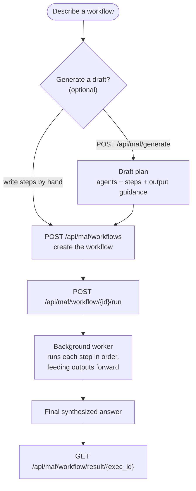
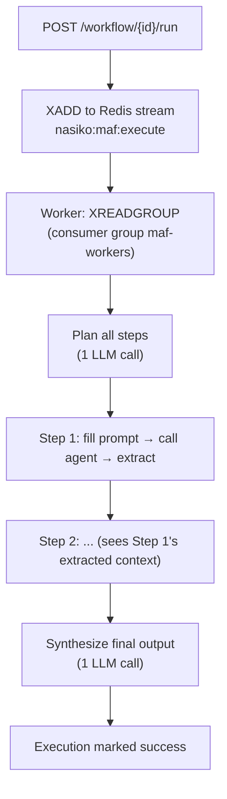

A routed chat request picks *one* agent to answer a query — see the [routing engine
guide](/platform/llm-router) for how that decision gets made. A **MAF (Multi-Agent Flow) workflow**
is different: it's a named, ordered sequence of steps, each bound to a specific agent, where each
step's output feeds the next and a final step synthesizes everything into one answer.

Reach for a workflow when a task genuinely needs several specialist agents chained together —
research, then analyze, then summarize — rather than a single best-match agent handling it end to
end.

<Warning>
  A MAF step calling its agent is a direct call to that agent's endpoint — it does **not** go
  through the same path as routed chat, so it isn't subject to the [flow guard](/platform/orchestrator#the-flow-guard)'s
  cascade limits (depth, fan-out, token budget, timeout, cycles) or to [agent-to-agent
  ACL](/onboarding/acl/overview) checks. A step can call any agent it's assigned, regardless of what
  an allowlist would otherwise permit. The workflow-authoring boundary — who can create a workflow
  and which agent ids they put in it — is the access control that applies here. See [what doesn't
  apply here](#what-doesnt-apply-here-flow-guard-and-agent-acl) below for the full detail.
</Warning>

## The model: define, generate, run



**Define a workflow** — `POST /api/maf/workflows` with a name, an optional description, and a list
of steps. Each step needs a task description and either an explicit agent, or nothing at all: steps
with no agent specified are auto-assigned via the routing engine at creation time. Manage workflows
with `GET /api/maf/workflows` (list yours), and `GET` / `PUT` / `DELETE /api/maf/workflow/{id}` to
read, edit, or remove one.

**Generate a draft from plain language** (optional) — `POST /api/maf/generate` takes a
natural-language description of what you want done, looks at the agents you have registered, and
returns a ready-to-review draft: a workflow name, description, output-synthesis guidance, and a step
list with agent assignments already filled in. Review and adjust it, then create it for real with
`POST /api/maf/workflows`. This requires an LLM to be configured on the control plane — it returns a
`503` if none is available.

**Run it** — `POST /api/maf/workflow/{id}/run` queues an execution and returns immediately with
`202 Accepted` and an `execution_id`; the workflow itself runs off the request path. Poll
`GET /api/maf/workflow/result/{exec_id}` (or `GET /api/maf/execution/{id}`) for status and the final
output. `GET /api/maf/workflow/{id}/executions` lists run history for one workflow;
`GET /api/maf/executions` lists every execution across all of your workflows — each entry carries
attempt/retry counts, tokens used, duration, and the per-step results.

## What a step carries

Each step you define names an agent and a short task description. At run time, the platform expands
that into an actual prompt — resolving placeholders from earlier steps' outputs — plus an
"extraction goal" describing what to pull out of that agent's reply. As execution proceeds, each
step's status moves `pending → running → success` (or `failed`), and the platform records token
usage and latency per step. A workflow also carries `output_generation` guidance: instructions for
how to turn all the step outputs into one coherent final answer.

## Reliability

Runs aren't executed inline on the HTTP request — they're queued and picked up by a background
worker, so a slow or multi-step workflow doesn't tie up a client connection. Failed steps retry
automatically up to a configurable attempt limit (`MAF_MAX_ATTEMPTS`, default `3`), and executions
that were in flight when a server restarts are picked back up rather than lost.

## Example

Create a two-step workflow — the first step names an agent explicitly, the second lets the routing
engine assign one automatically — then run it and fetch the result:

```sh
curl -X POST https://<control-plane>/api/maf/workflows \
  -H "Authorization: Bearer $TOKEN" -H "Content-Type: application/json" \
  -d '{
    "name": "research-and-summarize",
    "steps": [
      { "task_description": "Research recent news on topic X", "agent_id": "<research-agent-uuid>" },
      { "task_description": "Summarize the research into 3 bullet points" }
    ]
  }'
# -> { "data": { "id": "<workflow-id>", "name": "research-and-summarize", ... } }

curl -X POST https://<control-plane>/api/maf/workflow/<workflow-id>/run \
  -H "Authorization: Bearer $TOKEN"
# -> 202 { "execution_id": "<execution-id>", "execution_number": 1, "execution_count": 1 }

curl https://<control-plane>/api/maf/workflow/result/<execution-id> \
  -H "Authorization: Bearer $TOKEN"
# -> { "data": { "status": "success", "output": "...", "step_results": [ ... ] } }
```

---

## Underneath: planner, executor, worker

This section covers what happens beneath `POST /api/maf/workflow/{id}/run` — how a queued execution
actually gets processed, what happens when a worker crashes mid-run, and — because it's a genuinely
different code path from routed chat, not a variant of it — exactly which of the platform's usual
inter-agent guarantees do and don't apply to a MAF step calling its agent.

"Planner" covers two distinct things depending on when it runs:

- **Draft-time planning** (`POST /api/maf/generate`) — one LLM call turns a natural-language
  description plus your registered agents into a full draft: a name, a description, output-synthesis
  guidance, and a step list with agents already assigned. This is optional and only shapes what gets
  saved as the workflow's definition.
- **Run-time planning** — every execution, regardless of whether the workflow was hand-written or
  generated, re-plans at the start of the run: a fresh LLM call turns each step's stored task
  description into a concrete prompt template and an extraction goal, generated new on every run
  rather than reused from creation time.

The **executor** then walks the steps in order. For each one: it builds a context block out of every
prior step's extracted result, asks an LLM to fill the current step's prompt template with values
from that context (skipped entirely — no LLM call — if the template has no placeholders left to
fill), calls the step's agent, asks an LLM to extract exactly what the next step needs out of that
agent's raw reply, and persists the step's status, prompt, extracted result, and token/latency
numbers before moving to the next step. A final LLM call synthesizes every step's extracted output
into one answer, following the draft-time output-synthesis guidance. A single execution can
therefore involve as many as four distinct kinds of LLM call (plan, per-step prompt-fill, per-step
extract, final synthesis) on top of the agent calls themselves.



### The worker: Redis Streams, not a database poll

Unlike the [build worker](/platform/agent-registry#the-build-worker), which polls a Postgres table,
the MAF worker is a Redis Streams consumer on a single stream (`nasiko:maf:execute`) with one
consumer group (`maf-workers`). Each server process registers a unique consumer name (hostname plus
OS process id), so multiple replicas can pull from the same stream without double-processing a
message.

Crash recovery works the same way Redis Streams are designed for: a message a consumer read but
never acknowledged (because that consumer process died mid-execution) stays in the group's pending
entries list. Every worker runs `XAUTOCLAIM` once at startup and again periodically, reclaiming any
message that's been pending for more than ten minutes and reprocessing it — so an execution that was
in flight when a replica was killed doesn't just vanish, it gets picked up again automatically,
without anyone needing to notice and manually restart it.

Retries are capped by `MAF_MAX_ATTEMPTS` (default `3`), tracked per execution row. A failed run that
hasn't exhausted its attempts is reset to `pending` and re-enqueued for another try; one that has is
marked terminally `failed` so nothing keeps waiting on it.

### Auto-assignment uses the routing engine — manual assignment doesn't check ACL

A step created without an explicit agent is auto-assigned using the same three-stage
[routing engine](/platform/orchestrator#the-routingengine-trait) used elsewhere on the platform,
scoped to the agents the creating user can access; if the engine itself errors, workflow creation
falls back to matching the task description by keyword against that user's own registered agents.

A step created **with** an explicit agent id, by contrast, is not currently re-checked against the
creating user's access to that agent — only that the agent exists and isn't soft-deleted. Keep this
in mind if you're building workflows programmatically from agent ids you didn't derive from that
user's own accessible-agent list.

### What doesn't apply here: flow guard and agent ACL

This is the most important architectural difference to understand if you're reasoning about MAF's
guarantees using what you already know about routed chat: **a MAF step calling its agent is a direct
call from the executor to that agent's own resolved endpoint — it does not go through the same
call path that routed chat and the ReAct orchestrator use, and consequently:**

- It is **not** subject to the [flow guard's](/platform/orchestrator#the-flow-guard) cascade limits
  — max depth, max fan-out, token budget, wall-clock timeout, or cycle detection. Those limits exist
  specifically to bound an open-ended, LLM-directed call chain that could in principle recurse or
  fan out unpredictably; a MAF workflow's steps are a fixed, pre-defined linear sequence you wrote or
  reviewed yourself, so the platform doesn't apply the same cascade protection to it.
- It is **not** subject to [agent-to-agent ACL](/platform/acl#agent--agent) checks either — there's
  no `agent_acl` lookup on a step-to-agent call. A step can call any agent it's been assigned,
  regardless of whether an `agent_acl` allowlist would otherwise permit that pairing.

What a MAF execution *does* still get: each step derives its own deterministic `traceparent` (from
the execution id and step index via UUIDv5), so every step lands as its own distinct trace in Tempo
even though the whole execution shares one MAF execution id — see
[observability](/platform/observability) for how that ties into the session/trace model elsewhere.
Token usage is tracked per step, combining the run-time LLM calls with the called agent's own
reported usage (the executor polls Tempo briefly for the agent's span before finalizing a step's
total, since an agent's own usage data is rarely available the instant its call returns).

<Warning>
  Because MAF bypasses both the flow guard and agent ACL, the workflow-authoring boundary — who can
  create a workflow, and which agent ids they name in it — is the only access control acting on
  which agents a MAF execution actually reaches. Don't assume a flow-guard or ACL rule that
  protects an agent from unwanted routed-chat traffic also protects it from being named as a MAF
  step.
</Warning>

## Route surface

| Method | Endpoint | Purpose |
| --- | --- | --- |
| `GET` / `POST` | `/api/maf/workflows` | List your workflows / create one |
| `POST` | `/api/maf/generate` | Draft a workflow from a natural-language description |
| `GET`/`PUT`/`DELETE` | `/api/maf/workflow/{id}` | Read, edit, or remove a workflow |
| `POST` | `/api/maf/workflow/{id}/run` | Queue an execution — returns `202` immediately with an `execution_id` |
| `GET` | `/api/maf/workflow/{id}/executions` | Run history for one workflow |
| `GET` | `/api/maf/executions` | Every execution across all your workflows |
| `GET` | `/api/maf/execution/{id}` | One execution's status |
| `GET` | `/api/maf/workflow/result/{exec_id}` | Poll for status and the final output |

## Related

<CardGroup cols={2}>
  <Card title="Orchestrator" href="/platform/orchestrator">
    The routing engine MAF uses for auto-assignment, and the flow guard MAF steps skip.
  </Card>
  <Card title="Access control" href="/platform/acl">
    The agent-to-agent ACL model a MAF step-to-agent call doesn't currently pass through.
  </Card>
  <Card title="Observability" href="/platform/observability">
    How per-step traces stay distinguishable within one execution.
  </Card>
  <Card title="ADLC" href="/adlc/overview">
    Building and deploying the agents a workflow calls into.
  </Card>
</CardGroup>
