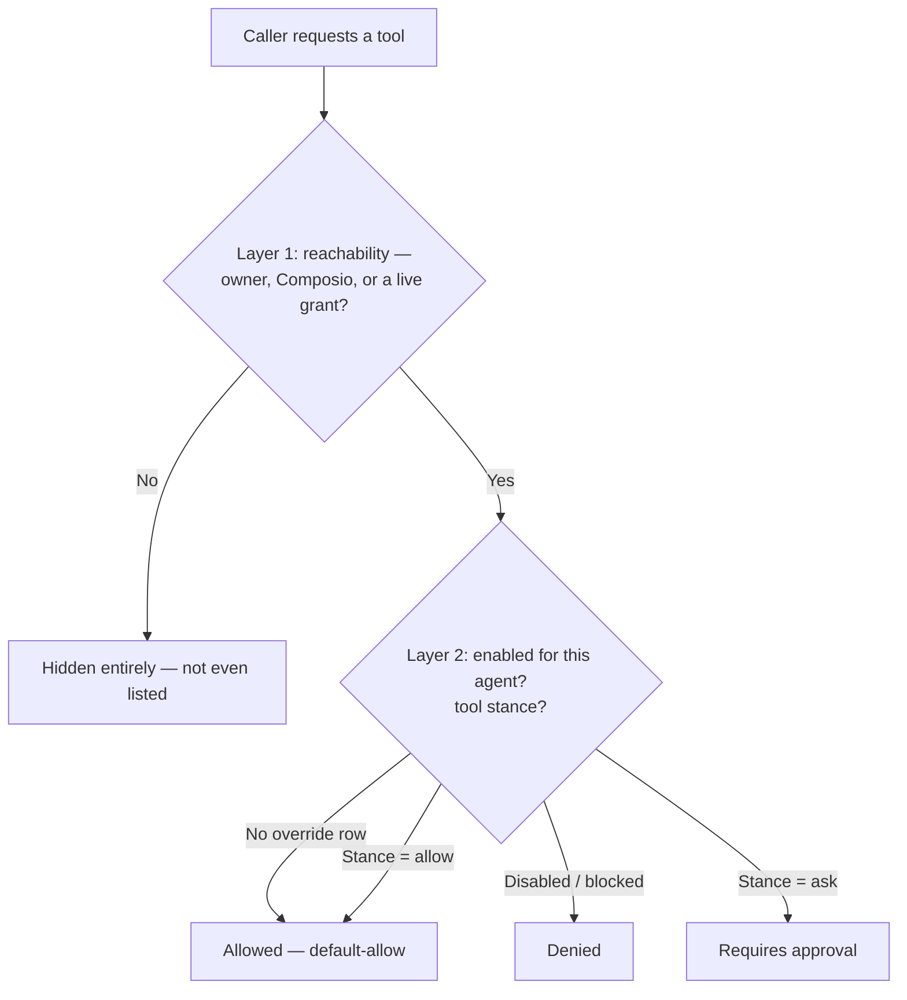

The [MCP gateway guide](/guides/mcp/overview) covers connecting and sharing connectors from a
user's point of view. This page goes underneath that: how the gateway decides who's calling and
what they can reach on every single request, and — because an uploaded MCP server is the platform
running arbitrary third-party code for the first time, not a curated example agent — the extra
hardening applied specifically to that path.

## Why identity has to be resolved per request

An agent is untrusted, user-authored code, deployed once but serving many different users over its
lifetime. Its identity can't be baked in at deploy time — the gateway has to work out who's calling
and on whose behalf on every single `tools/call`, without ever handing the agent a credential it
could replay elsewhere.

The [delegation token](/guides/mcp/overview#the-delegation-token) is what makes that possible: an
actor-pattern JWT binding two identities (`sub = user_id`, `act = agent_id`, `aud = "mcp"`) with a
short expiry, minted by the same server process that forwards a user's request to an agent
container. Two properties fall out of minting and validating it in one process rather than across a
network hop:

- **It's stateless.** No database write happens per request to mint or validate it — cost doesn't
  scale with traffic.
- **There's no second place to misinterpret it.** The signature, audience, and expiry are all
  checked in the same middleware that resolves identity from its claims; there's no separate
  service that could parse the token's meaning differently.

The route it authenticates, `POST /api/mcp`, is deliberately **not** behind the platform's normal
session-JWT middleware — it's the only credential type that route accepts, and an agent structurally
can never hold a real session credential in the first place, since the agent-proxy module strips
`Authorization`/`Cookie` before a request ever reaches a container.

## Permission resolution: two layers, always in that order

Every `tools/list` and `tools/call` resolves through exactly two layers, and the ordering is
security-critical, not just logical:

**Layer 1 (reachability)** must be re-confirmed on every check, never assumed from a prior pass — a
revoked grant that left a stale permissive Layer 2 row behind must never continue to let someone in.
That's why revoking a share doesn't just delete the grant row: it deletes the grantee's stored
connection credential in the same transaction, so a later re-grant can never silently reactivate an
old session.

**Layer 2 (per-agent permission)** is **default-allow, not default-insert** — nowhere does "no row"
mean "no access." A missing override for a `(user, agent, connector)` triple means fully allowed; a
row only ever exists to *restrict* one. This is what makes sharing a connector take effect on every
one of the grantee's agents immediately, with zero rows written at share time.

Both checks are repeated in full at `tools/call` time, not only at `tools/list` time — closing the
window where a tool could be listed as available and then blocked a moment before it's actually
invoked.

### Why caching can't go stale

All caching is Redis-backed (shared across replicas — this is a horizontally scaled service, so an
in-process cache would be inconsistent). The merged tool manifest is cached under a key built from
**both** the caller's current connector set and a permission hash — a deterministic digest of every
active rule and disabled-connector flag for that `(user, agent)` pair. Either component changing
recomputes to a different hash, which is itself part of the cache key, so a permission edit is
visible on the very next call with no separate "remember to invalidate this too" step to forget.

## The hardened path for uploaded MCP servers

Registering a Composio toolkit or an already-running MCP server by URL is one thing; letting a user
**upload source and have the platform build and run it** is a materially different trust boundary —
it's the platform executing arbitrary third-party code, not just calling out to it. That path gets
its own set of protections layered on top of everything above.

### Build and deploy

`POST /api/mcp/connectors/upload` (a zip) or `/upload-github` (a repository URL, re-validated
against the allowed-host list at both the handler layer and again at clone time — defense in depth,
not one check trusting the other) queues a build through the same shared build worker that handles
agent uploads — see [agent runtime](/platform/agent#the-build-worker) for the crash-isolation,
retry, and stuck-job recovery guarantees that path inherits. Once built, the image is deployed with
two properties no other workload on the platform gets by default:

- **OS-level hardening** — a fixed non-root uid, a read-only root filesystem (with a small writable
  `/tmp` tmpfs), every Linux capability dropped, and no-new-privileges. Every other agent deployment
  defaults to none of this; an uploaded MCP server is the one case that gets it unconditionally.
  Kubernetes hardens every pod this way already, so the setting is a no-op there — it matters
  specifically under the Docker runtime.
- **Network segmentation** — the container is deployed onto a dedicated network
  (`MCP_SERVERS_NETWORK`, default `nasiko-mcp-servers-net`), isolated from the network everything
  else (the database, Redis, and agent containers) shares. Under Kubernetes, namespace isolation
  plus a tighter `NetworkPolicy` variant applies instead: unlike an agent, an MCP connector never
  needs an outbound path back to the control plane for A2A traffic, so it doesn't get one.

After deploy, the gateway polls the new container for MCP readiness (up to roughly ninety seconds)
before marking the connector `running` and syncing its tool catalog. If readiness never succeeds,
the container is torn down rather than left running unreachable — a failed build never leaves an
orphaned workload behind.

<Note>
  A per-connector secret token is generated once and injected into the container's environment,
  which the uploaded server *may* optionally read and echo back on inbound calls. The platform does
  not currently require or verify that it comes back — this is a deliberately deferred piece of
  defense-in-depth, not a load-bearing check yet.
</Note>

### The SSRF-guard split

A user can register a custom MCP server at any URL they choose, and the gateway will make server-side
requests to it — the textbook SSRF setup. Two distinct HTTP clients exist specifically to close
that off without also blocking the platform's own legitimate internal traffic:

- **The guarded client** — used for every user-supplied MCP server URL. Its DNS resolver rejects any
  address that resolves to loopback, private, link-local, or the cloud metadata range, both at
  registration time and — critically — again at the moment of every actual connection. Checking only
  once at registration would leave a DNS-rebinding gap: a hostname could legitimately resolve to a
  public address when it's registered and a private one later. Resolving and connecting through the
  same guarded path in one step closes that gap entirely.
- **The unguarded client** — used *only* for `MCPServerConfig`s whose `trusted` flag is `true`,
  which means the connector's URL was never typed by a user in the first place: it's an uploaded
  server whose address was resolved by the platform's own runtime after building and deploying it.
  That address is necessarily internal — it's a container on the platform's own network — which is
  exactly what the guard exists to reject for user-supplied input. `trusted` is computed in exactly
  one place, derived from the connector's own `source_kind` column, and is never accepted as input
  from a request body, a CLI flag, or anywhere else external.

### Self-heal on a stale endpoint

An uploaded connector's internal network address isn't necessarily stable forever — a restart or
redeploy can change it. Rather than treating a connection failure as permanent, the gateway holds an
`EndpointRefresher` seam: on a failed call to an uploaded connector, it re-resolves that connector's
current address from the runtime and retries, instead of surfacing a dead connector until someone
notices and manually reconnects it.

## API surface

**Agent-facing** — the only route an agent ever calls, authenticated by delegation token:

| Method | Endpoint | Purpose |
| --- | --- | --- |
| `POST` | `/api/mcp` | JSON-RPC — `initialize`, `ping`, `tools/list`, `tools/call` |

**Management** — session-authenticated, access-controlled:

| Method | Endpoint | Purpose |
| --- | --- | --- |
| `GET` | `/api/mcp/catalog` | Browse connectable services |
| `POST` | `/api/mcp/connect` | Unified connect, any auth type |
| `GET` / `POST` | `/api/mcp/connectors` | List visible connectors / register a custom MCP server |
| `POST` | `/api/mcp/connectors/probe` | Detect a candidate server's auth type before registering |
| `GET`/`POST`/`DELETE` | `/api/mcp/connectors/{id}/share` | List, grant, or revoke a share |
| `POST` | `/api/mcp/connectors/upload` | Upload a zip — build and deploy a custom MCP server |
| `POST` | `/api/mcp/connectors/upload-github` | Same, from a GitHub repository URL |
| `GET` | `/api/mcp/connectors/{id}/build-status`, `/build-logs` | Poll an upload build's progress |
| `GET`/`PUT` | `/api/mcp/agents/{agent_id}/tools` | View / bulk-update per-tool allow/ask/block rules |
| `DELETE` | `/api/mcp/agents/{agent_id}/permissions` | Reset an agent's overrides to full default-allow |
| `POST` | `/api/mcp/webhooks/composio` | HMAC-verified Composio token-expiry events |

## Related

<CardGroup cols={2}>
  <Card title="MCP gateway overview" href="/guides/mcp/overview">
    The user-facing model: connectors, delegation tokens, tool call shapes.
  </Card>
  <Card title="Deploy your own MCP server" href="/guides/mcp/internal-mcp-deployment">
    The task-oriented walkthrough for the upload path this page hardens.
  </Card>
  <Card title="Per-agent tool permissions" href="/guides/acl/user-agent-mcp">
    Configuring the allow/ask/block rules Layer 2 enforces.
  </Card>
  <Card title="Agent runtime reference" href="/platform/agent">
    The shared build worker that uploaded MCP servers queue through.
  </Card>
</CardGroup>
