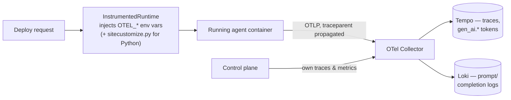

Every agent deployed through Nasiko is traced and logged without a single line of code added to
the agent itself. This page covers how that's actually done — the write path that instruments an
agent at deploy time, the read path that turns raw traces and logs into sessions and FinOps
numbers, and the full API surface those dashboards are built on.

## Write path: instrumentation with no agent code changes

Every deployment — regardless of runtime — passes through `InstrumentedRuntime<R>`, a wrapper
around the `ContainerRuntime` trait that injects OpenTelemetry configuration into the deployment
spec before it ever reaches Docker or Kubernetes: the OTLP endpoint, protocol, headers, and sample
ratio all become environment variables on the container, sourced from the control plane's own
`OTEL_*` configuration. An agent doesn't opt into this — it's applied uniformly to every deploy.

For Python agents specifically, the injector goes one step further: it patches the agent's
Dockerfile to install a `sitecustomize.py` file into the image. Python imports `sitecustomize`
automatically before any of the agent's own code runs, which is what makes the rest of this
possible with zero source changes:

- Initializes the OpenTelemetry SDK using the injected env vars, so the agent starts exporting
  OTLP the moment it boots.
- Reads the inbound `traceparent` header off each request and propagates it, so a hop this agent
  makes to another agent (or the LLM) shares the same trace as the request that triggered it.
- Wraps `AgentExecutor.execute()` in a span carrying `session.id` — this is the one attribute that
  ties a whole conversation's worth of separate traces back together (see below).
- Instruments outbound OpenAI calls so `gen_ai.*` attributes (model, token counts) land on the span
  automatically.

<Note>
  Some Python web-server frameworks prepend their own `sitecustomize.py` to `PYTHONPATH`, which
  would otherwise shadow the injected one and silently disable all of this. The injector accounts
  for that case specifically rather than assuming a bare Python runtime.
</Note>

Every agent, whatever language it's written in, exports OTLP to a collector, which fans out to two
backends:

- **Tempo** — traces, including `gen_ai.*` attributes (model, input/output token counts) on every
  LLM-call span.
- **Loki** — prompt and completion log lines, so you can read the actual text an agent sent to and
  received from an LLM, not just the metadata.

The control plane exports its own traces and metrics the same way — routing decisions, proxy hops,
and its own request handling show up in the same Tempo instance agents export to.

## The session / trace / flow model

Three terms describe three different granularities of the same conversation, and it's worth being
precise about which is which:

- **Session** — one end-to-end user query, identified by the A2A `contextId`. This is the unit you
  see as a row in the session list.
- **Trace** — every hop involved in answering that one query (the routing decision, the chosen
  agent's own LLM calls, any agent it calls in turn) shares one trace, because every hop propagates
  the same W3C `traceparent`. A multi-agent interaction is therefore **one trace**, not one trace
  per agent — you get per-LLM-span token and model attributes within that single trace rather than
  a set of disconnected ones you'd have to stitch together yourself.
- **Flow** — the [flow guard's](/platform/orchestrator#the-flow-guard) view of the same
  `traceparent`-linked call chain, used to enforce cascade limits rather than to display data. A
  flow and a trace are keyed by the same id; they're just two different consumers of it.

Costs are computed by applying `gen_ai.usage.*` token counts to a `model_pricing` lookup
(`DbPricing`): each model has an `input_price_per_1m` / `output_price_per_1m` row, versioned by an
`effective_from`/`effective_until` window so a price change doesn't retroactively re-cost historical
spend. Lookups are cached in memory for five minutes; a model with no matching row falls back to a
static built-in price table rather than silently reporting zero cost.

<Note>
  A [MAF workflow](/platform/maf) step derives its own `traceparent` deterministically from the
  execution id and step index, so each step's agent call lands under its own distinct trace even
  though the whole execution shares one MAF execution id — useful when the same agent appears in
  more than one step and you need to tell their token usage apart.
</Note>

## Read path: the `ObservabilityProvider` trait

Every dashboard route is backed by one trait, implemented by `TempoLokiProvider` (an HTTP client
pair over Tempo's and Loki's query APIs):

| Method | Backs |
| --- | --- |
| `sessions_for_agent` | Session list for one agent — groups traces by `session.id`, skipping traces that never got one (infrastructure noise) |
| `get_session` | Full drill-down for one session: one trace summary per query in that conversation |
| `get_trace` | One full trace, every span, for one query |
| `get_span` | A single span's detail within a trace |
| `agent_stats` | Aggregate call/latency/success stats for one agent |
| `agent_finops` | Aggregate cost data for one agent |
| `count_user_traces` | Trace volume for a user, used by usage/quota views |
| `query_logs` | Loki log lines for an agent |
| `cost` | Token-usage-to-dollar conversion via `DbPricing` |

This is the seam the platform extends for organization-scoped observability (e.g. restricting which
agents' sessions a given viewer can see) without forking the Tempo/Loki query logic itself.

## API surface

All under `/api/observability/*`, authenticated the same way as the rest of the platform API:

| Method | Endpoint | Purpose |
| --- | --- | --- |
| `GET` | `session/list` | Sessions for an agent (paginated by time range) |
| `GET` | `session/{id}` | Full drill-down for one session |
| `GET` | `trace/{id}` | One full trace, every span |
| `GET` | `span/{trace_id}/{span_id}` | One span's detail |
| `GET` | `agent/{id}/stats` | Aggregate call/latency/success stats |
| `GET` | `finops/dashboard` | Aggregate cost dashboard data |
| `GET` | `finops/insights` | LLM-generated narrative over the aggregated FinOps data |
| `GET` | `agents/{ref}/logs`, `agents/{ref}/logs/stream` | Loki log lines for an agent, with a streaming variant |

## Configuration

| Env var | Purpose |
| --- | --- |
| `OTEL_EXPORTER_OTLP_ENDPOINT` | Where agents and the control plane export OTLP |
| `OTEL_*` (protocol, headers, sample ratio) | Exporter tuning, injected into every deployment |
| `OTEL_INSTRUMENTATION_GENAI_CAPTURE_MESSAGE_CONTENT` | Whether prompt/completion *text* (not just token counts) is captured — off this, you still get `gen_ai.*` token metrics without the raw message content |
| `TEMPO_URL` | Tempo query endpoint used by the read path |
| `LOKI_URL` | Loki query endpoint used by the read path |

## Related

<CardGroup cols={2}>
  <Card title="Architecture overview" href="/architecture/overview">
    Where the OTel collector, Tempo, and Loki sit in the system diagram.
  </Card>
  <Card title="Core concepts" href="/architecture/core-concepts">
    Session and flow, defined alongside the platform's other vocabulary.
  </Card>
  <Card title="Orchestrator internals" href="/platform/orchestrator">
    The flow guard that shares the same `traceparent`-derived id used here.
  </Card>
  <Card title="Agent runtime reference" href="/platform/agent-registry">
    How `InstrumentedRuntime` fits into the deploy path more broadly.
  </Card>
</CardGroup>
