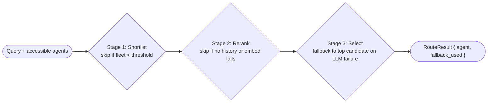

The [routing engine guide](/platform/llm-router) covers what routing does from the outside: send a
query without naming an agent, get an answer from whichever agent was the best fit. This page goes
underneath that — the pipeline's internals, exactly how each stage degrades when something upstream
is slow or unavailable, where the pipeline is actually invoked today, and the flow guard that
bounds every agent-to-agent call regardless of how the target agent was chosen.

## The `RoutingEngine` trait

Agent selection is implemented behind one trait with a single method:

```rust
#[async_trait]
pub trait RoutingEngine: Send + Sync {
    async fn route(&self, req: RouteRequest, pool: &PgPool) -> Result<RouteResult, RouterError>;
}
```

A `RouteRequest` carries the query text, the caller's user and session id, and any file parts. A
successful `route()` call returns a `RouteResult { agent, fallback_used }` — one chosen agent, plus
a flag saying whether the choice came from the real pipeline or a fallback path. This is the seam
the platform extends for organization-scoped routing (an RBAC-aware candidate pre-filter layered in
front of the same three stages) without touching the pipeline itself.

### Stage 1 — shortlist

The engine fetches every agent the caller can access and the session's recent conversation history
in parallel, then narrows the candidate set by semantic similarity between the query and each
agent's description (OpenAI-compatible embeddings, cached per agent so the whole catalog isn't
re-embedded on every request).

This stage is skipped outright — no embedding calls made at all — when the accessible fleet is
smaller than `ROUTER_SHORTLIST_THRESHOLD` (default `15`). Below that size, shortlisting can't
usefully narrow anything, so every agent becomes a Stage 2 candidate directly. `ROUTER_SHORTLIST_SIZE`
(default `10`) caps how many candidates survive the stage when it does run.

### Stage 2 — rerank

The shortlisted candidates are re-scored using the conversation's own context — the running history
plus the current query, embedded once and compared against the same agent embeddings — so a
follow-up question is more likely to stay with the agent already handling the session.

Two conditions return the shortlist unchanged rather than reranking it: an empty conversation
history (no embed call is made at all — nothing to rerank against), and an embedding-provider
failure mid-call, which is caught and logged as a warning rather than propagated. Either way, Stage
2 never fails the request — worst case, it's a no-op.

### Stage 3 — select

An LLM (`ROUTER_MODEL`, default `gpt-4o`) makes the final call among the Stage 2 candidates, given
the query and conversation history. If that call errors for any reason, the engine picks the first
(highest-ranked) candidate instead and sets `fallback_used: true` on the result, with a reasoning
string of `"fallback: {error}"` — the request is never rejected because the selection LLM had a bad
moment.



Every stage is built the same way: **fail forward, never fail the request.** Nothing about the
pipeline can turn a routing hiccup into a user-visible error — the worst case is a slightly worse
agent pick, never a dropped query.

## Logging never blocks the response

Every `route()` call fires a `tokio::spawn` at the very end to write a `RouterLogEntry` into
`router_request_log` — the response has already been sent back to the caller by the time this
write happens. The log entry captures far more than the final pick: agents considered, the
selection reasoning text, `fallback_used`, per-stage candidate counts (`stage1_candidates`,
`stage2_candidates`), per-stage latencies (`registry_fetch_ms`, `selection_llm_ms`,
`total_latency_ms`), the embedding model used, and a foreign key into `token_usage` for the Stage 3
selector call's own token cost (tracked under `operation_type = 'router_selection'`, separate from
the chosen agent's own LLM spend).

An hourly background job refreshes the `agent_selection_stats` materialized view from that log
table — this is what backs `GET /api/orchestrator/stats`. Because it's a materialized view refreshed
on an interval rather than a live query, the stats endpoint can lag the underlying log table by up
to an hour; go to the log table (or a specific session's trace) directly if you need up-to-the-second
numbers.

<Note>
  The token-cost bookkeeping in `router_request_log` is why the routing decision itself shows up
  as its own line item in TokenOps data — the LLM call that *picks* an agent is metered exactly like
  any other LLM call, not folded silently into whichever agent gets chosen.
</Note>

## Where the pipeline actually runs

It's worth being precise about this, because it's easy to assume the three-stage pipeline is what
picks the agent on every chat message — it isn't, not directly.

`POST /api/orchestrator/a2a` dispatches on the request's `agent_id` metadata three ways:

- **An explicit `agent_id`** (not `"orchestrator"`) — proxies straight to that agent's container.
  No routing decision happens at all.
- **No `agent_id`, or `agent_id: "orchestrator"`** — runs a multi-turn ReAct orchestrator loop. It
  resolves every agent the caller can access, exposes each one as a callable tool (name,
  description, skills), and lets an LLM decide — across as many as ten turns — which agent or
  agents to call and in what order, rather than making one up-front pick. This is a fundamentally
  different mechanism from the three-stage pipeline: no shortlist/rerank happens here, and the LLM
  can call more than one agent per query.
- The three-stage `RoutingEngine` pipeline described above is invoked directly in one place today:
  **auto-assigning an agent to a step of a [MAF workflow](/platform/maf)** when that step's
  definition doesn't name one. If the engine errors, workflow creation falls back to matching the
  step's task description against the caller's own registered agents by name/description rather
  than failing the request.

Both mechanisms answer a version of "which agent should handle this," and both are extension seams
(routing engine implementations, and the orchestrator's agent registry) — but they're not the same
code path, and a workflow step's auto-assignment doesn't go through a ReAct loop, just as a live
chat message doesn't go through Stage 1/2/3 shortlisting.

## The flow guard

Whichever path picked the destination — a direct proxy, an orchestrator tool call, or a MAF step —
every agent-to-agent call the control plane makes is wrapped by a flow guard before it happens. It
enforces five cascade limits, all backed by a single Redis hash per flow (keyed by the W3C
`traceparent`'s trace id, e.g. `flow:<trace_id>`):

| Limit | Enforced on | Rejection |
| --- | --- | --- |
| Max call depth | Every hop, both before and after incrementing | `MaxDepthExceeded` |
| Cycle detection | Every hop, against the running call chain | `CycleDetected` |
| Max fan-out | Every hop, against total invocations so far | `MaxFanOutExceeded` |
| Token budget | After each hop reports its token usage | `TokenBudgetExhausted` |
| Wall-clock timeout | Every hop, against the flow's `started_at` | `FlowTimeout` |

The guard's own state — depth, the call chain (a comma-joined list of agent ids), total invocation
count, total tokens used, and start time — lives entirely in that one Redis hash, initialized when
the flow starts and expiring on a TTL (`NASIKO_FLOW_STATE_TTL_SECS`, default `300`s) so an
abandoned flow doesn't leak state forever. A `before_call` check runs *before* an agent is invoked
(reject early rather than pay for a call that will be rejected anyway), and depth/fan-out counters
are incremented atomically as part of recording the invocation, with a second check immediately
after in case a concurrent hop pushed a counter over the limit between the pre-check and the
increment.

<Warning>
  If Redis is unreachable, the guard returns `GuardUnavailable` and the call is rejected outright —
  it fails **closed**, not open. The threat model here is explicitly unvetted, user-authored agent
  and MCP-server code: silently disabling cascade limits during a Redis outage would turn that
  outage into an unbounded recursion/fan-out window, which is a worse failure mode than a temporary
  outage rejecting new agent-to-agent calls.
</Warning>

Configuration (environment variables on the control plane):

| Env var | Default | Limit |
| --- | --- | --- |
| `NASIKO_FLOW_MAX_DEPTH` | `5` | Max call depth |
| `NASIKO_FLOW_MAX_FAN_OUT` | `20` | Max fan-out (total invocations in the flow) |
| `NASIKO_FLOW_MAX_TOKENS` | `100000` | Token budget per flow |
| `NASIKO_FLOW_TIMEOUT_SECS` | `120` | Wall-clock timeout |
| `NASIKO_FLOW_STATE_TTL_SECS` | `300` | Redis key TTL for a flow's guard state |

<Note>
  A flow's state key is derived from the trace id in its `traceparent`, the same identifier that
  ties every hop's spans together into one trace in Tempo — see [observability](/platform/observability)
  for how that same id is used on the read side. `FlowEventBus` also broadcasts flow-status updates
  in-process for the UI's live flow view (`/api/flows/*`), independent of the Redis-backed guard
  state itself.
</Note>

## Related

<CardGroup cols={2}>
  <Card title="Routing engine guide" href="/platform/llm-router">
    The task-oriented walkthrough: tuning knobs, inspecting decisions, reusable LLM configs.
  </Card>
  <Card title="MAF platform reference" href="/platform/maf">
    How workflow steps get their agents assigned, and why MAF calls don't go through this same flow guard.
  </Card>
  <Card title="Architecture overview" href="/architecture/overview">
    Where routing and the flow guard sit in the overall request path.
  </Card>
  <Card title="Core concepts" href="/architecture/core-concepts">
    Definitions for session, flow, and routing engine vs. orchestration.
  </Card>
</CardGroup>
