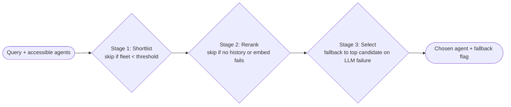

The [routing engine guide](/platform/llm-router) covers what routing does. This page covers how each stage behaves under failure, where the pipeline runs, and the flow guard.

## How each stage degrades

Agent selection runs in three stages, and **every stage fails forward**. The worst case is a slightly worse agent pick, never a dropped query.

**Stage 1 — shortlist.** Fetches every accessible agent and the session's recent history in parallel, then narrows candidates by semantic similarity between the query and each agent's description. Agent embeddings are cached per agent.

Skipped entirely — no embedding calls — when the accessible fleet is smaller than `ROUTER_SHORTLIST_THRESHOLD` (default `15`); below that, every agent goes straight to Stage 2. `ROUTER_SHORTLIST_SIZE` (default `10`) caps surviving candidates.

**Stage 2 — rerank.** Re-scores candidates against the conversation's running history plus the current query, so a follow-up is more likely to stay with the agent already handling the session.

Two conditions return the shortlist unchanged: empty conversation history (no embedding call at all) and an embedding-provider failure, which is caught and logged rather than propagated.

**Stage 3 — select.** An LLM (`ROUTER_MODEL`, default `gpt-4o`) makes the final call. If it errors, the engine picks the highest-ranked remaining candidate and marks the decision `fallback_used: true`.

## Routing decisions are logged off the response path

Decisions are recorded asynchronously — the response is already back by the time the log write happens. Each captures the agents considered, the reasoning, whether a fallback was used, per-stage candidate counts and latencies, and the selection call's token cost.

<Note>
  The LLM call that *picks* an agent is metered like any other, not folded into the chosen agent — so routing cost is its own line item in [TokenOps](/platform/tokenops).
</Note>

Aggregated stats come from `GET /api/orchestrator/stats`. They're a periodic rollup, so they lag recent activity — for a specific query, open its session trace.

## Where the pipeline actually runs

The three-stage pipeline is *not* what picks the agent on every chat message.

`POST /api/orchestrator/a2a` dispatches on `agent_id` metadata:

| Request | What runs |
| --- | --- |
| Explicit `agent_id` (not `"orchestrator"`) | Proxies straight to that container. No routing decision. |
| No `agent_id`, or `"orchestrator"` | A multi-turn ReAct loop — every accessible agent is exposed as a callable tool, and an LLM decides across up to ten turns which agents to call and in what order. No shortlist or rerank; more than one agent per query is possible. |

The three-stage pipeline is invoked in exactly one place today: **auto-assigning an agent to a [MAF workflow](/platform/maf) step** when the step doesn't name one. If it errors, workflow creation falls back to matching the step's task description against the caller's registered agents by name and description.

Both mechanisms answer "which agent should handle this," but they're different code paths. A workflow step's auto-assignment doesn't run a ReAct loop; a chat message doesn't run Stage 1/2/3.

## The flow guard

Every agent-to-agent call the control plane makes is wrapped by a flow guard, regardless of how the destination was picked. It enforces five limits scoped to a single flow, identified by the W3C `traceparent` trace ID:

| Limit | Enforced on | Rejection |
| --- | --- | --- |
| Max call depth | Every hop, before and after incrementing | `MaxDepthExceeded` |
| Cycle detection | Every hop, against the running call chain | `CycleDetected` |
| Max fan-out | Every hop, against total invocations so far | `MaxFanOutExceeded` |
| Token budget | After each hop reports usage | `TokenBudgetExhausted` |
| Wall-clock timeout | Every hop, against the flow's start time | `FlowTimeout` |

Checks run *before* an agent is invoked, so a rejected call is never paid for. Counters are re-checked after incrementing in case a concurrent hop crossed a limit in between.

<Warning>
  If the guard's backing store is unreachable, it **fails closed** — calls are rejected rather than allowed through unchecked. The threat model is unvetted, user-authored agent and MCP code: silently disabling cascade limits during an outage would open an unbounded recursion and fan-out window.
</Warning>

| Env var | Default | Limit |
| --- | --- | --- |
| `NASIKO_FLOW_MAX_DEPTH` | `5` | Max call depth |
| `NASIKO_FLOW_MAX_FAN_OUT` | `20` | Total invocations per flow |
| `NASIKO_FLOW_MAX_TOKENS` | `100000` | Token budget per flow |
| `NASIKO_FLOW_TIMEOUT_SECS` | `120` | Wall-clock timeout |
| `NASIKO_FLOW_STATE_TTL_SECS` | `300` | How long guard state is retained |

<Note>
  Live flow status is broadcast to the dashboard's [Flows view](/product/observability#flows) (`/api/flows/*`) independently of the guard's limit tracking.
</Note>

## Related

<CardGroup cols={2}>
  <Card title="Routing engine guide" href="/platform/llm-router">
    Tuning knobs, inspecting decisions, reusable LLM configs.
  </Card>
  <Card title="LLM router dashboard" href="/product/llm-router">
    Configure providers and per-level models.
  </Card>
  <Card title="MAF" href="/platform/maf">
    Multi-agent workflows and step assignment.
  </Card>
  <Card title="Observability" href="/product/observability">
    Sessions, traces, and how a flow's hops tie together.
  </Card>
</CardGroup>
