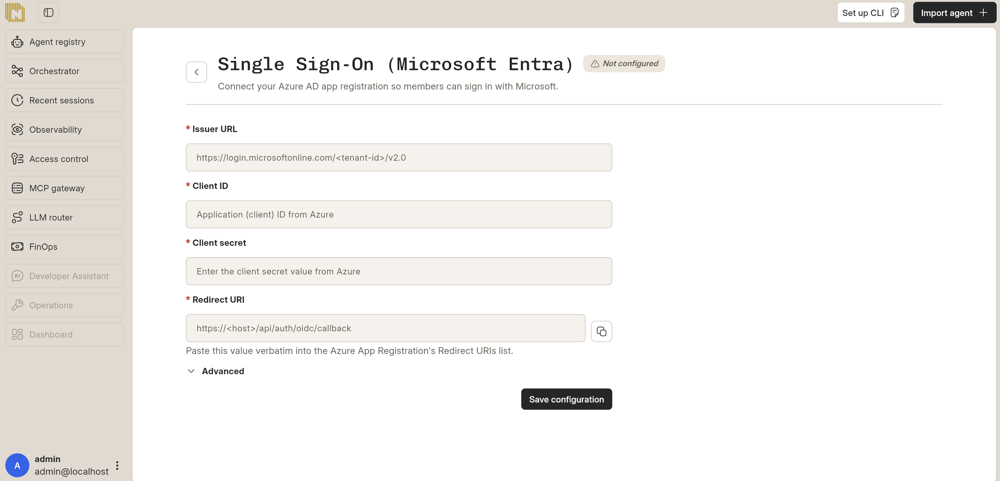
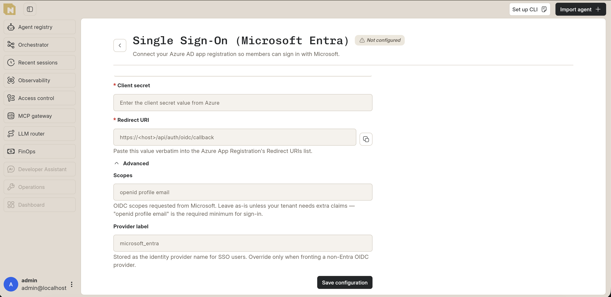

<Warning>
  **Enterprise feature.** The open-source edition ships the underlying `oidc` client library and
  the settings storage referenced below (`GET`/`PUT /api/settings`), but no OSS route actually
  performs the `/api/auth/oidc/login`/`callback` redirect — that login flow, plus the group-mapping
  and directory-sync sections further down this page, are `nasiko-ee` only.
</Warning>

Nasiko's login flow is built against generic OIDC, so Entra ID, Okta, Auth0, Keycloak, and Google all work the same way. This guide uses **Microsoft Entra ID** as the worked example.

## Two ways to configure it

| Method | Takes effect | Notes |
| --- | --- | --- |
| **Environment variables** | On restart | Set at deploy time |
| **Admin settings API** (`PUT /api/settings`, superuser only) | Next login | Stored in the database, client secret encrypted at rest. Takes precedence over environment variables. |

```bash
curl -X PUT https://<your-host>/api/settings \
  -H "Authorization: Bearer <superuser-token>" \
  -H "Content-Type: application/json" \
  -d '{
    "oidc_issuer_url": "https://login.microsoftonline.com/<tenant-id>/v2.0",
    "oidc_client_id": "<client-id>",
    "oidc_client_secret": "<client-secret>",
    "oidc_redirect_uri": "https://<your-host>/api/auth/oidc/callback"
  }'
```

`GET /api/settings` never returns the raw secret, only whether one is configured. Omitting `oidc_client_secret` on a later update leaves the stored value untouched; sending an empty string clears it.

The dashboard writes to the same store, under **Settings → Single Sign-On (Microsoft Entra)** — the four required fields, with a **Not configured** badge until all four are saved.

{/*
<Frame>
  
</Frame>
*/}

{/*
<Frame>
  
</Frame>
*/}

## Setup

<Steps>
  <Step title="Register an application">
    In Entra ID: [Microsoft Entra admin center](https://entra.microsoft.com) → **Identity → Applications → App registrations → New registration**.

    - **Name** — anything recognizable, e.g. `Nasiko Platform`
    - **Supported account types** — single tenant, unless you need multi-tenant
    - **Redirect URI** — platform type **Web**, value `https://<your-host>/api/auth/oidc/callback`. Must match `OIDC_REDIRECT_URI` exactly: scheme, host, path, no trailing slash.
  </Step>

  <Step title="Collect issuer, client ID, and secret">
    From **Overview**: the **Application (client) ID** and **Directory (tenant) ID**. From **Certificates & secrets → New client secret**: copy the value immediately — it's shown once.

    Entra ID issuer URL:

    ```
    https://login.microsoftonline.com/<tenant-id>/v2.0
    ```
  </Step>

  <Step title="Grant API permissions">
    Add delegated `openid`, `profile`, and `email` under **Microsoft Graph** — usually pre-granted.

    For [directory sync](#directory-sync), also add `User.Read.All` as an **Application** permission and grant admin consent.
  </Step>

  <Step title="Set the variables">
    | Variable | Value | Required |
    |---|---|---|
    | `OIDC_ISSUER_URL` | Your provider's issuer URL | Yes |
    | `OIDC_CLIENT_ID` | Application/client ID | Yes |
    | `OIDC_CLIENT_SECRET` | Client secret value | Yes |
    | `OIDC_REDIRECT_URI` | `https://<your-host>/api/auth/oidc/callback` | Yes |
    | `OIDC_SCOPES` | Defaults to `openid profile email` | No |
    | `OIDC_PROVIDER_LABEL` | Defaults to `microsoft_entra` | No |

    SSO stays disabled until all four required variables are set. `GET /api/auth/oidc/status` returns `{"configured": true|false}` so your login screen can show or hide the button.
  </Step>

  <Step title="Test it">
    Open `https://<your-host>/api/auth/oidc/login`. You should reach your provider's login screen, then be redirected back to `/api/auth/oidc/callback` with a session established.
  </Step>
</Steps>

## Routes

| Route | Purpose |
|---|---|
| `GET /api/auth/oidc/login` | Redirects to your provider's consent screen |
| `GET /api/auth/oidc/callback` | Exchanges the code and logs the user in |
| `GET /api/auth/oidc/status` | `{"configured": bool}` — safe for the frontend |

## First login

A new SSO sign-in creates a local Nasiko user with the base role and no team or department. An admin promotes them from the **Users** page or the users API. See [access control](/onboarding/acl/overview).

To skip that step, map groups to roles or pre-provision your organization — both below.

## Automatic role assignment via security groups

Entra ID's `roles` claim is a flat list with no concept of team or department, so **security groups** are the right primitive. Create one group per team or department, then map each to an internal role, team, and department.

Group claims aren't on by default. In your app registration: **Token configuration → Add groups claim → Security groups**, leaving the format as group **Object IDs**.

Then create a mapping (superuser only):

```bash
curl -X POST https://<your-host>/api/oidc/group-mappings \
  -H "Authorization: Bearer <superuser-token>" \
  -H "Content-Type: application/json" \
  -d '{
    "external_group_id": "<security-group-object-id>",
    "role": "team_lead",
    "team_id": "<internal-team-uuid>",
    "department_id": "<internal-department-uuid>",
    "description": "Platform team lead group"
  }'
```

At least one of `role`, `team_id`, or `department_id` is required. If a user matches several mappings, the highest-ranked role's mapping wins outright — its fields apply together, not merged field by field. A user matching nothing is left untouched, so a manually promoted admin is never reset.

| Route | Purpose |
|---|---|
| `GET /api/oidc/group-mappings` | List mappings |
| `POST /api/oidc/group-mappings` | Create |
| `GET /api/oidc/group-mappings/{id}` | Get one |
| `PUT /api/oidc/group-mappings/{id}` | Update |
| `DELETE /api/oidc/group-mappings/{id}` | Delete |

All are superuser only.

<Warning>
  A group mapping can grant `admin` through group membership alone, so even read access to these routes is superuser-only — stricter than most org management endpoints.
</Warning>

**Known limitation:** a user belonging to more groups than your provider's token overage threshold (typically 150 for Entra ID) has the `groups` claim omitted entirely and is left unmapped.

## Directory sync

Rather than waiting for each user to log in and land as a bare member, an admin can trigger a one-time sync that fetches your tenant's directory, infers a department/team hierarchy, and creates matching users up front. First-time SSO sign-ins are matched to their pre-created account by identity-provider object ID, with role, team, and department already correct.

Sync reuses the same app registration via Microsoft Graph's client-credentials flow, so the only extra setup is `User.Read.All` plus admin consent. Entra ID only, since it relies on Microsoft Graph.

**Hierarchy inference** uses two directory attributes — `department` (free text) and `manager` — grouped per distinct department value:

- No manager inside their department group → **department head**
- A direct report of the head who has their own reports → **team lead**
- Everyone below a lead, at any depth → that lead's team
- Reports straight to the head with no reports of their own → department member, no team
- No `department` attribute → plain member

Trigger it (superuser only):

```bash
curl -X POST https://<your-host>/api/org/directory-sync \
  -H "Authorization: Bearer <superuser-token>"
```

Or:

```bash
nasiko-ee admin directory-sync
```

The response reports `departments_created`, `teams_created`, `users_created`, `users_skipped_existing`, and `users_without_department`, plus any per-row errors, which don't abort the run.

Sync is insert-only and safe to re-run. An identity seen from a prior sync or a prior login is never touched again. It won't revert a manual change, and it won't pick up later structural changes in your directory for someone already synced — reassign those users from **Users** or **Team Access**.

## Related

- [Secret management overview](/platform/secret-manager/overview) — how the client secret is protected
- [Access control overview](/onboarding/acl/overview) — the role hierarchy SSO users resolve into
