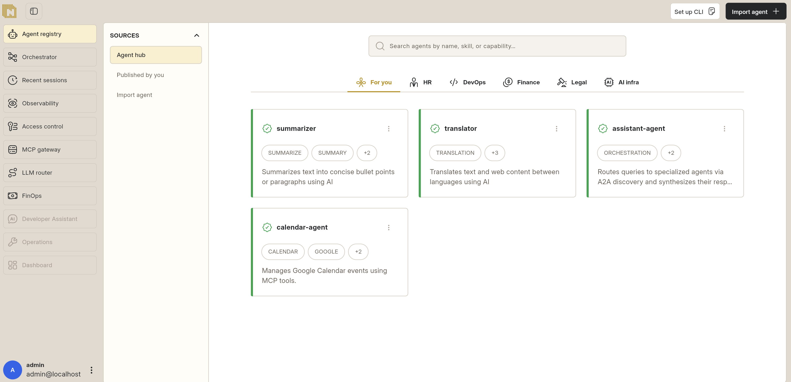
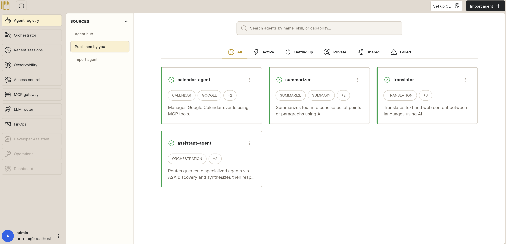
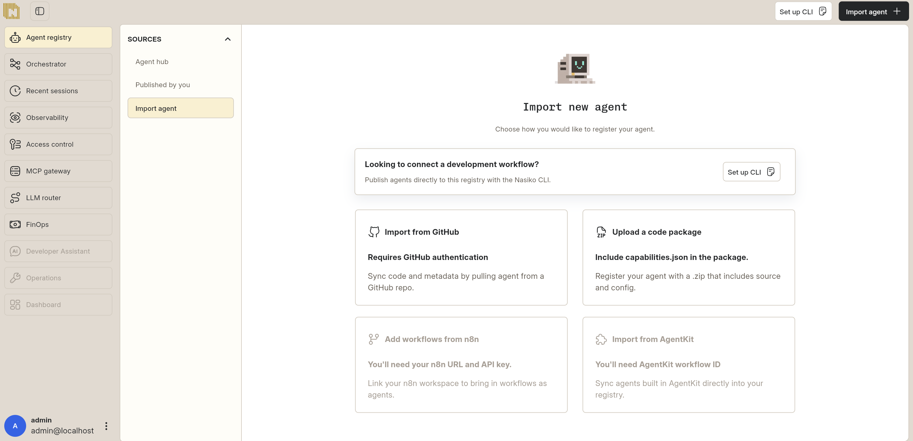

Five screens cover agents: **Agents** (the catalog), **Your Agents** (what you've deployed), **Add Agent** (three ways to register one), the agent card, and **Builds**. To script the same lifecycle instead, see [Agent Development Lifecycle](/adlc/overview).

## Agents — the catalog

Lists every agent you can reach, running or not.

- **Search** filters by name, description, or tag as you type
- **Category** filters by tag, built from every tag in the catalog

Each card shows a name, status badge, description, and up to three tags, with **Details** (the agent card) and **Chat** ([direct chat](/product/chat)).

<Frame>
  
</Frame>

## Your Agents — what you've deployed

Lists the containers you manage. The stats bar shows **running**, **stopped**, and **error** counts — click one to filter, click again to clear. Search filters by name or image; sort by **Name**, **Status**, or **Version**.

Each card shows the name, status badge, and `name:version`. Actions depend on state:

| State | Actions |
| --- | --- |
| Running | **Restart**, **Stop**, **Delete** |
| Stopped | **Deploy**, **Delete** |

**Deploy** opens a modal for environment variables — import them from saved secrets, or set new ones (which are saved to the agent's secrets for future deploys). **Delete** confirms, then stops the container and removes it from the registry.

An agent in an error state shows an inline link to its logs.

<Frame>
  
</Frame>

## Add Agent

Three methods, plus **Import from AgentKit** marked coming soon.

| Method | Requirement | What happens |
| --- | --- | --- |
| **Import from GitHub** | GitHub connected; `AgentCard.json` at repo root | Pick a repo from a searchable list, then **Import** clones and builds it |
| **Upload a code package** | `.zip` with `skill.json` at root | Uploads immediately and builds |
| **Import from OCI registry** | An artifact reference, e.g. `nasiko/my-agent:v1.0` | Pulls the pre-built image |

Upload and GitHub both build the container image first — watch progress in [Builds](#builds). Failures show an error in place of the redirect.

<Frame>
  
</Frame>

## The agent card

Opens from **Details** in the catalog or an agent's name in Your Agents. The top shows name, avatar, version, tags, and description. Header actions: **Restart** and **Stop** when running, **Delete**, and **Start session** for [direct chat](/product/chat).

**Overview**
- **Skills** — each registered skill; one with a sample query opens a chat with it pre-filled
- **Quick performance** — recent trace count, total cost, p50/p99 latency
- **Agent details** — provider, project and docs URLs, ID, version, protocol, transport, default I/O
- **Capabilities** — streaming, push notifications, state history, and current chat reachability
- **Access Control** — which agents this one may call, and who can access it (public badge, or user/team/department/agent grants)

**Settings** — read-only image, port, status, and replica count.

**Logs** — recent container output. Choose 50, 100, or 500 lines; **Follow** keeps the view at the latest line.

## Builds

Every image build triggered from the browser, in a searchable paginated table. Each row: short build ID, version tag, image reference, status badge (**success**, **building**, **failed**, **queued**, **cancelled**), source repo link for GitHub builds, and start time.

Opening a build shows a summary, a numbered step breakdown with durations when steps are recorded, and log output. Logs stream live while a build is still in **building**.

## Related

<CardGroup cols={2}>
  <Card title="Agent Development Lifecycle" icon="terminal" href="/adlc/overview">
    The same lifecycle from the CLI.
  </Card>
  <Card title="A2A agents and frameworks" icon="plug" href="/adlc/a2a-agents">
    What your container must expose.
  </Card>
  <Card title="Chat" icon="messages" href="/product/chat">
    Talk to an agent directly or via the orchestrator.
  </Card>
  <Card title="Observability" icon="chart-line" href="/product/observability">
    Traces, logs, and cost over time.
  </Card>
</CardGroup>
