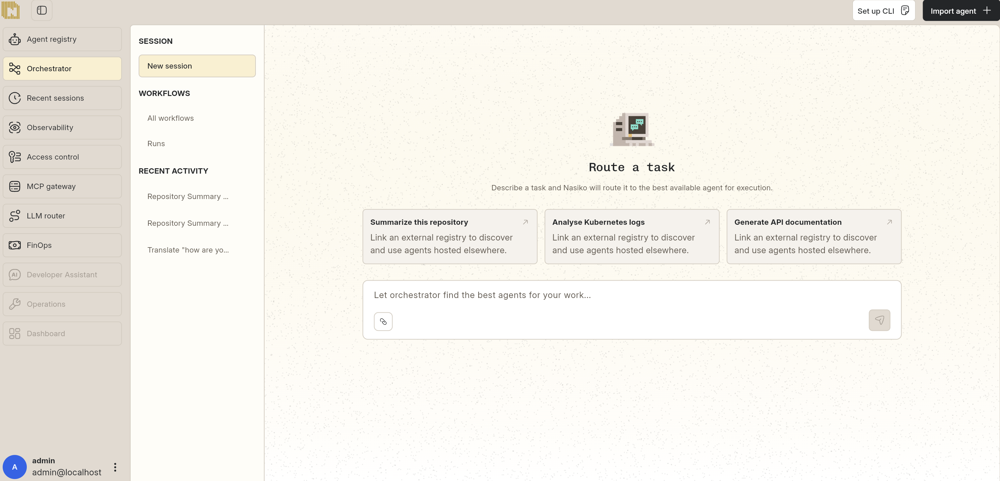
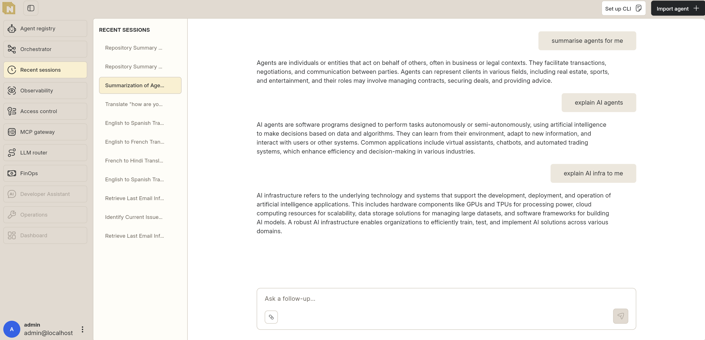

The dashboard has two chat surfaces. **Orchestrator** answers a question without you naming an agent. **Chat** is a direct conversation with one agent. Both are saved to [Sessions](/product/observability).

## Orchestrator

The home screen for chat. Type a question; the platform decides which agent answers.

<Frame>
  
</Frame>

From the input box you can:

- Type a message and submit it
- Record voice input — click the microphone or press **F8** / **Alt+R**; audio is transcribed before sending
- Attach a file

**Recent agents** below the input links straight into a direct conversation with a running agent.

### Sending a message

1. A **Working…** indicator shows step-by-step activity as the platform consults agents. Expand it to watch.
2. The response streams in with full markdown — lists, tables, and syntax-highlighted code, each block with a **Copy** button.
3. A toolbar appears with **Copy** for the whole reply and a **view trace** link when a trace was produced.
4. **Continue in chat** opens the full Chat screen for the same session.

Your message goes to the routing engine, not a specific container — see [A2A agents](/adlc/a2a-agents). For a fixed sequence of steps across several agents, use a [multi-agent flow](/platform/maf) instead.

## Direct chat

A conversation with one agent, no routing. You get here from **Chat** on an agent's detail page, **Start** on an agent card, or a card in Orchestrator's **Recent agents**.

The header shows the agent's name, a **Running** indicator, and a link to its card. A fresh conversation shows suggested prompt chips.

Sending works the same as Orchestrator — same input box, same streaming display. The difference: your message is proxied straight to that agent's container. Each reply also gets a **Retry** action.

Opening a chat with a `session_id` in the URL reloads that conversation instead of starting fresh.

## Sessions

Every conversation is saved the moment you send the first message, whether it came from Orchestrator or direct chat. Revisit history and drill into traces in [Sessions](/product/observability).

**Recent sessions** in the sidebar lists past conversations by title. Opening one restores the full transcript with an **Ask a follow-up** box, so you continue where you left off rather than starting over.

<Frame>
  
</Frame>
