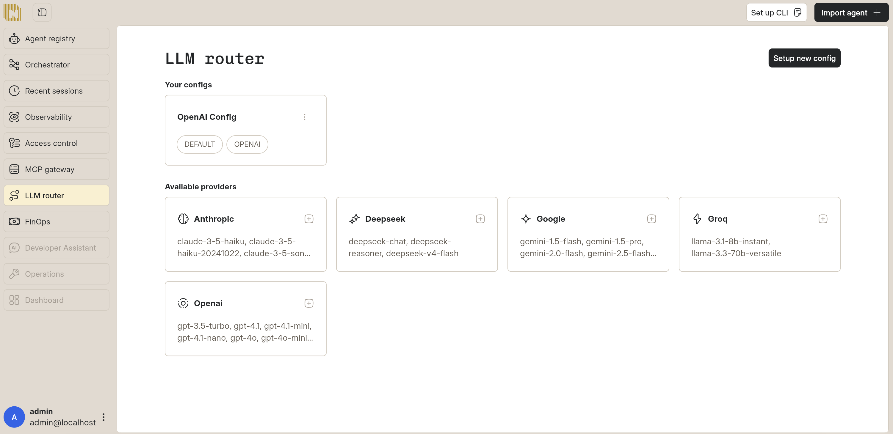
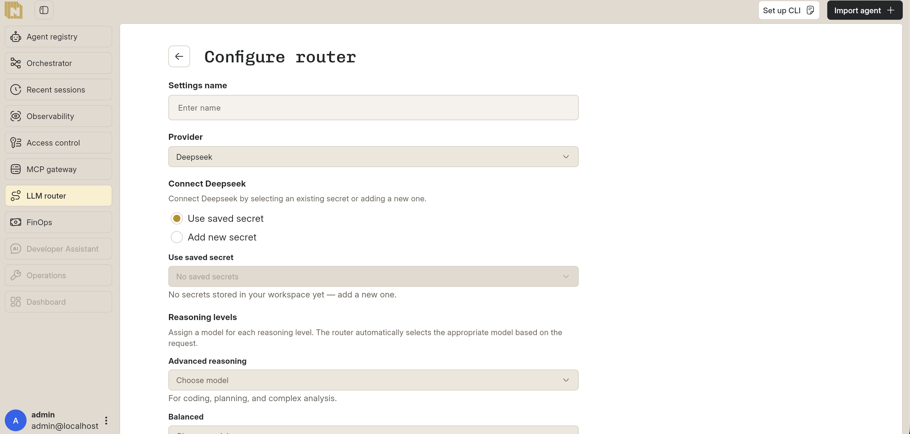
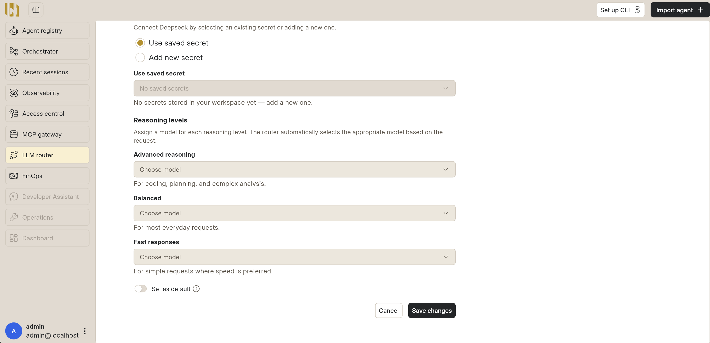

The **LLM router** screen assigns a model to each of three **reasoning levels**. The router then picks the right-sized model per request, so a quick lookup doesn't run on your most expensive model.

## The three reasoning levels

| Level | Use it for |
| --- | --- |
| **Advanced reasoning** | Coding, planning, complex analysis |
| **Balanced** | Most everyday requests |
| **Fast responses** | Simple requests where speed is preferred |

Every config assigns a model per level. One is enough.

## The screen

With no configs, the page shows **No configs yet!** and a **Setup new config** button.

Each config appears as a card with its name, provider, the model per level, and a **Default** badge on the current default. Actions: **Make default** (on non-default configs) and **Delete**.

**Available providers** below lists every usable provider with its model count and a **Requires API key** chip. Clicking one opens the config form with that provider preselected.

<Frame>
  
</Frame>

## Creating a config

<Steps>
  <Step title="Name it and pick a provider">
    The provider choice unlocks the reasoning-level dropdowns — they stay disabled until the platform knows which models to offer.
  </Step>
  <Step title="Connect the provider">
    - **Use saved secret** (default) — pick from secrets already in your workspace. See [Secrets](/product/administration#secrets).
    - **Add new secret** — name it (e.g. `OPENAI_API_KEY`) and paste the key. Stored encrypted, used only for that provider.

    Either way, the key is never displayed back to you.
  </Step>
  <Step title="Assign a model per level">
    Each dropdown lists only that provider's models; switching provider repopulates all three.

    At least one is required — saving all three empty returns *"Choose a model for at least one reasoning level."*
  </Step>
  <Step title="Save it">
    Tick **Make this the default routing config** if it should be the default. It's ticked automatically for your first config.
  </Step>
</Steps>

<Frame>
  
</Frame>

<Frame>
  
</Frame>

<Note>
  Changing the default config changes which models subsequent requests use. It doesn't affect conversations that already ran, and it doesn't restart any agent.
</Note>

## Model routing vs. agent selection

Two things get called "routing." This screen controls only the first:

| Decision | Where it's configured |
| --- | --- |
| Which **model** answers | This screen |
| Which **agent** answers | [Routing and flow limits](/platform/orchestrator) |

Agent selection decides *who* handles the request; your routing config decides *which model* that work runs on.

<Tip>
  To lock a specific agent to one model regardless — for compliance, say — use a per-agent LLM config: `nasiko llm-config --pin`. See [the routing engine guide](/platform/llm-router#reusable-llm-configs).
</Tip>

## Related

<CardGroup cols={2}>
  <Card title="Routing engine guide" icon="route" href="/platform/llm-router">
    Per-agent configs, pinning, and CLI equivalents.
  </Card>
  <Card title="Routing and flow limits" icon="diagram-project" href="/platform/orchestrator">
    How the platform picks which *agent* handles a query.
  </Card>
  <Card title="TokenOps dashboard" icon="coins" href="/product/tokenops">
    What your model choices cost.
  </Card>
  <Card title="Secrets" icon="lock" href="/product/administration#secrets">
    Where provider keys are stored and rotated.
  </Card>
</CardGroup>
