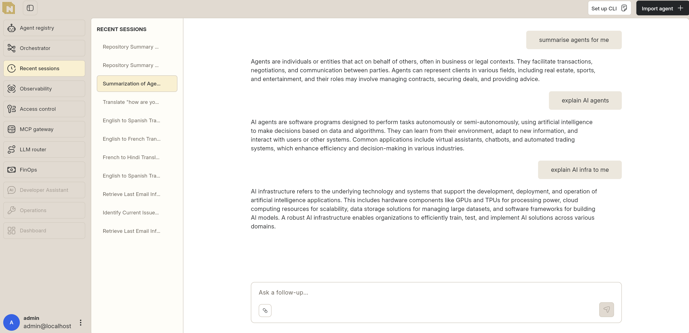

Three screens cover what happened: **Sessions**, **Session Trace**, and **Flows**. Token spend lives on the [TokenOps dashboard](/product/tokenops).

| Term | What it is |
| --- | --- |
| **Session** | One query, grouped by its conversation context — a row in the session list |
| **Trace** | Every hop behind that query: the agent's LLM calls plus any agent-to-agent calls |
| **Flow** | The same hop chain shown as a step-by-step timeline |

Session Trace and Flow Detail show much the same data from two angles.

## Sessions

Your past conversations, from Orchestrator or direct [Chat](/product/chat). Each row shows:

- The agent's name and initial avatar, or **Orchestrator** if no single agent handled it
- A message count and a preview of the last message
- Time since last active, grouped under **Today**, **Yesterday**, **This Week**, **Older**

Search filters by agent name or message text. **New Chat** starts fresh; the trash icon removes a session.

Clicking a session reopens the thread in Chat. A finished assistant reply carries a trace icon next to **Copy** — that opens its full trace.

{/*
<Frame>
  
</Frame>
*/}

## Session trace

Every span behind a single query, in order, including nested agent-to-agent calls.

The stats row shows **Spans**, **Duration**, **Tokens** (input + output), **Cost** when available, and the **Session** ID.

The span list is indented to show nesting. Each span shows its name, model for LLM calls, token count, and duration; a red dot marks an error. Click a span for its kind, span ID, status, start and end times, model, and input/output token split.

<Note>
  Traces take a few seconds to index. Opening one immediately after a conversation may say it isn't available yet — refresh.
</Note>

## Flows

Every multi-agent interaction, as a searchable sortable table:

| Column | Detail |
| --- | --- |
| **Flow ID** | Links to the detail page |
| **Query** | What started the flow |
| **Agent** | The originating agent |
| **Status** | Completed, running, failed, or timeout |
| **Calls** | Agent invocations in the flow |
| **Duration**, **Started** | Timing |

Search filters by agent name or query text.

### Flow detail

Summary cards for **Status**, **Root Agent**, **Duration**, **Started**, **Steps**, and **Query**, then a **Trace** timeline. Each step shows:

- A status badge
- The agent it called, with a preview of what was sent (hover for the full text)
- A bar sized and positioned to show when it ran relative to the whole flow — the slow hop is visible at a glance
- Its duration

<Note>
  Designing a fixed multi-step sequence rather than reviewing one that ran? See [multi-agent workflows](/platform/maf).
</Note>

## Tokens and cost

Token spend has its own screen — see [TokenOps](/product/tokenops) for per-agent cost, operations, agent hours, and latency by month, with CSV export.

Cost also appears inline: a session trace's stats row shows that query's token count and dollar cost, so you can attribute one expensive answer without leaving the trace.

## API

Everything these screens show is available under `/api/observability/*`:

| Method | Endpoint | Purpose |
| --- | --- | --- |
| `GET` | `session/list` | Sessions for an agent, paginated by time range |
| `GET` | `session/{id}` | Full drill-down for one session |
| `GET` | `trace/{id}` | One trace, every span |
| `GET` | `span/{trace_id}/{span_id}` | One span's detail |
| `GET` | `agent/{id}/stats` | Aggregate call, latency, and success stats |
| `GET` | `finops/dashboard` | Cost dashboard data — backs [TokenOps](/product/tokenops) |
| `POST` | `finops/insights` | LLM-generated narrative over the cost data |
| `GET` | `agents/{ref}/logs`, `agents/{ref}/logs/stream` | Log lines, with a streaming variant |

## Configuration

Agents are traced with no code changes — every deployment gets OpenTelemetry configuration injected into its spec, so instrumentation starts at boot and `traceparent` propagates across agent-to-agent hops automatically. If you run your own control plane, these are the knobs:

| Env var | Purpose |
| --- | --- |
| `OTEL_EXPORTER_OTLP_ENDPOINT` | Where agents and the control plane export traces |
| `OTEL_*` (protocol, headers, sample ratio) | Exporter tuning, injected into every deployment |
| `OTEL_INSTRUMENTATION_GENAI_CAPTURE_MESSAGE_CONTENT` | Whether prompt and completion *text* is captured. Off still gives token metrics without raw content. |
| `TEMPO_URL` | Trace query endpoint |
| `LOKI_URL` | Log query endpoint |

## Related

<CardGroup cols={2}>
  <Card title="Chat" icon="messages" href="/product/chat">
    Where sessions and traces come from.
  </Card>
  <Card title="Agents" icon="layers" href="/product/agents">
    Browse and manage deployed agents.
  </Card>
  <Card title="TokenOps dashboard" icon="coins" href="/product/tokenops">
    Spend per agent, month by month.
  </Card>
  <Card title="Multi-agent workflows" icon="diagram-project" href="/platform/maf">
    Design a fixed multi-step sequence.
  </Card>
</CardGroup>
