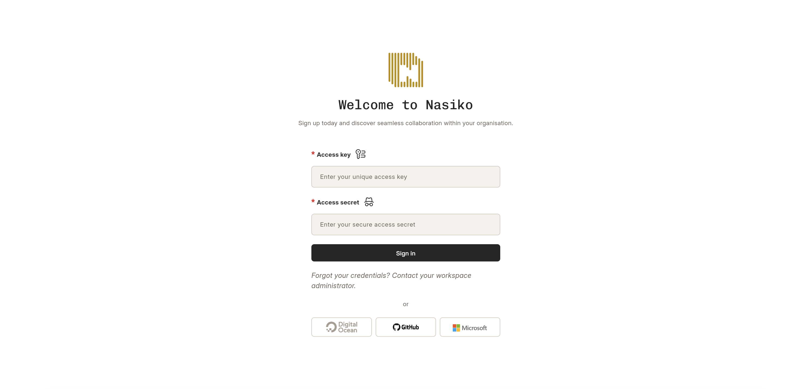

The dashboard is the web UI for your control plane. It ships inside the control plane server, so there's nothing extra to install or deploy, and it reads the same data your agents and API calls do.

## Signing in

Sign in with a username and password at your control plane URL. GitHub, Google, and Microsoft buttons appear only if your organization has enabled them.

<Warning>
  **Enterprise feature.** GitHub OAuth is wired in OSS. Microsoft/Google SSO buttons imply a
  working OIDC login route, which is `nasiko-ee` only — see [SSO setup](/platform/secret-manager/entra-id).
</Warning>

Sessions are stored in a secure cookie — you don't manage a token. When a session expires, the app returns you to the login screen.

{/*
<Frame>
  
</Frame>
*/}

Your own account details — role, status, member since, last login — are on **Profile**, reached from your name at the bottom of the sidebar.

## Navigation

Everyone with a login sees the same screens: **Orchestrator**, **Agents**, **Your Agents**, **Add Agent**, **Sessions**, **MCP gateway**, **Flows**, **LLM router**, **Builds**, **TokenOps**, **Secrets**, **Settings**, **Access Control**, **Users**, **Departments**, and **Teams**.

Some screens are view-only unless your role allows more:

| Screen | Who can act |
| --- | --- |
| **Users**, **Access Control** | Users with user-management permission |
| **Departments**, **Teams** | Administrators (everyone else can view) |

<Warning>
  **Enterprise feature.** Of the screens listed above, **Departments**, **Teams**, **Team
  Access**, **Agent Runtime**, and **Group Mappings** are all `nasiko-ee` org-hierarchy/cluster
  features with no OSS equivalent. **Users** and **Access Control** are partially real in OSS —
  basic account management and the per-agent access model exist — but without the role hierarchy
  described elsewhere in this section.
</Warning>

Three screens appear only once your role qualifies:

| Screen | Visible to | What it controls |
| --- | --- | --- |
| **Team Access** | Team or department managers, org admins | Which agents your group can reach |
| **Agent Runtime** | Administrators | Infrastructure settings for running agents |
| **Group Mappings** | Top-level administrators | How identity-provider groups map to Nasiko roles |

## Artifact registry

<Warning>
  **Enterprise feature.** The artifact registry is a standalone `nasiko-ee` service, not a
  control-plane feature — see [Artifact registry](/artifact-registry/overview). OSS ships only a
  generic client (`nasiko registry connect/search/list`) that can point at one if you have it.
</Warning>

Shared agents, skills, and templates live in the artifact registry — a separate app at its own URL. See [Artifact registry](/product/artifact-registry).

## Screens

<CardGroup cols={2}>
  <Card title="Chat" icon="messages" href="/product/chat">
    Talk to an agent directly, or let the orchestrator route your question.
  </Card>
  <Card title="Agents" icon="layers" href="/product/agents">
    Browse the catalog, deploy agents, manage the ones you own.
  </Card>
  <Card title="MCP gateway" icon="plug" href="/product/mcp-gateway">
    Register MCP servers and control which tools each agent may call.
  </Card>
  <Card title="LLM router" icon="route" href="/product/llm-router">
    Connect a provider and assign a model to each reasoning level.
  </Card>
  <Card title="Observability" icon="chart-line" href="/product/observability">
    Trace a conversation across every agent hop.
  </Card>
  <Card title="TokenOps" icon="coins" href="/product/tokenops">
    Spend per agent, month by month, with CSV export.
  </Card>
  <Card title="Administration" icon="users" href="/product/administration">
    Users, teams, departments, and access control.
  </Card>
  <Card title="Artifact registry" icon="package" href="/product/artifact-registry">
    Browse and publish shared agents, skills, and templates.
  </Card>
</CardGroup>
