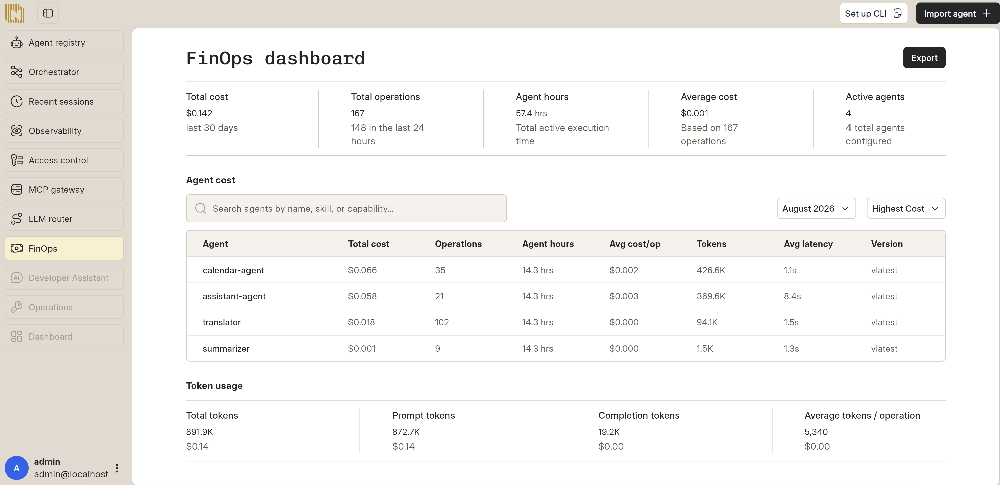

**TokenOps** answers what you spent this month, which agents drove it, and whether it's going up. Everything is scoped to a **period** — the current month plus the previous five.

## Summary strip

| Card | What it tells you |
| --- | --- |
| **Total tokens** | Token usage across every agent in the period |
| **Total operations** | Operations run, with the last-24-hours count underneath |
| **Agent hours** | Total active execution time |
| **Total cost** | Spend for the period, with the operation count it's based on |
| **Active agents** | How many agents did work, against the total configured |

The gap between **Active agents** and total configured is often the most useful number — deployed-but-idle agents show up here.

<Frame>
  
</Frame>

## Agent cost

| Column | Detail |
| --- | --- |
| **Agent** | Agent name |
| **Tokens** | Total tokens, abbreviated (`1.2M`, `12.3K`) |
| **Operations** | Operations handled |
| **Total cost** | Spend for the period |
| **Avg cost/op** | Cost ÷ operations — the number to compare agents doing similar work |
| **Agent hours** | Active execution time |
| **Avg latency** | Average response time in seconds |
| **Version** | Which version ran |

Three controls above it:

- **Search** — filter by agent name
- **Period** — current month or any of the previous five; changing it reloads the summary strip too
- **Sort** — **Most tokens**, **Highest cost**, **Most operations**, **Slowest**, or **Name**

**Export** downloads `tokenops.csv` reflecting your current search and sort — narrow to one team's agents and export just those.

## Token usage

A second strip splits totals four ways: **Total tokens**, **Prompt tokens**, **Completion tokens**, and **Average tokens / operation**.

The prompt/completion split is the practical cost lever. A high prompt share usually means context is being resent — a prompt-engineering problem. A high completion share means verbose outputs — a model or instruction problem.

<Note>
  The cost of the platform *choosing* an agent is metered as its own line item, so routing never inflates an agent's numbers. See [TokenOps](/platform/tokenops).
</Note>

## Where the numbers come from

Token counts are collected automatically from every LLM call — no instrumentation is added to your agents. Costs apply those counts to a per-model price table, versioned by date so a provider's price change doesn't re-cost last month. See [observability](/product/observability).

<Tip>
  For an LLM-generated summary of what changed rather than raw numbers, the `finops/insights` API returns exactly that — useful for a weekly digest. See [TokenOps](/platform/tokenops#where-you-see-it).
</Tip>

## Related

<CardGroup cols={2}>
  <Card title="TokenOps reference" icon="coins" href="/platform/tokenops">
    How token counts become dollar amounts.
  </Card>
  <Card title="Observability" icon="chart-line" href="/product/observability">
    Drill from a cost number into the traces behind it.
  </Card>
  <Card title="LLM router" icon="route" href="/product/llm-router">
    Change which models your agents use.
  </Card>
  <Card title="Agents" icon="layers" href="/product/agents">
    Stop or scale down expensive agents.
  </Card>
</CardGroup>
