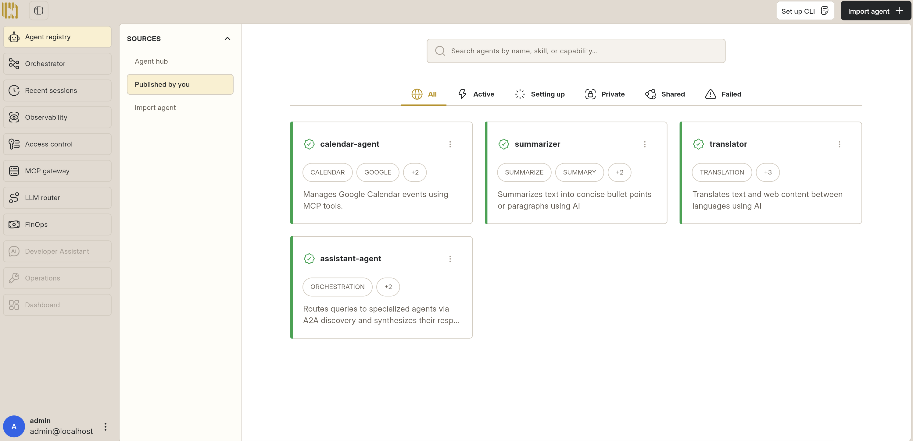

Scaffold an agent, run it locally, deploy it, and see it under governance.

Nasiko has two surfaces. Neither requires the other.

|  | What it's for | How you get in |
| --- | --- | --- |
| **CLI** (`nasiko`) | Build agents — scaffold, run, test, deploy, version. | `cargo install --path cli --force`. See [Setup Your CLI](/cli/setup). |
| **Dashboard** | Govern your tenant — registry, access, traces, cost, secrets. | Sign in at your control plane URL. |

Steps 1–4 use the CLI. Step 5 uses the dashboard. To govern agents someone else deployed, skip to step 5.

## Prerequisites

- Docker
- An account with deploy permission — see [ACL](/onboarding/acl/overview)
- A model provider API key (`OPENAI_API_KEY` or similar)

<Warning>
  This one key actually needs to go in three separate places, and each is independent of the
  others — having it in one doesn't mean it's set for the rest:

  1. **Your project's own `.env`** — read by `nasiko run .` for local testing (step 3 below).
  2. **A per-agent secret** — `nasiko secrets set OPENAI_API_KEY <key> --agent <name>`, read by
     `nasiko deploy .`/`nasiko upload .` (step 4). Deploy does *not* read your project's `.env` —
     skip this and the deployed agent chats with a 502/empty error and no explanation. See
     [managing agent secrets](/platform/secret-manager/user-secrets).
  3. **The control plane's own environment** — needed for the routing engine and orchestrator chat
     (`nasiko chat "..."` with no agent name). If you're running `nasiko up` locally, answer its
     setup wizard prompt for `OPENAI_API_KEY` rather than pressing Enter past it — see
     [Setup Your CLI](/cli/setup) for the wizard and what happens if you skip it.
</Warning>

## Get started

<Steps>
  <Step title="Install and authenticate the CLI">
    ```bash
    git clone https://github.com/nasiko-ai/nasiko-rs.git && cd nasiko-rs
    cargo install --path cli --force
    nasiko up
    nasiko auth login
    ```

    `nasiko up` starts a local control plane and connects the CLI to it as cluster `local`. `auth login` stores your token in `~/.nasiko/config.json`. Options: [Setup Your CLI](/cli/setup).
  </Step>

  <Step title="Scaffold an agent">
    ```bash
    nasiko new openai my-first-agent
    cd my-first-agent
    ```

    Writes an `AgentCard.json`, a `Dockerfile`, and starter source. Run `nasiko new` with no arguments for a wizard. Templates: [Sample Agents](/artifact-registry/sample-agents).
  </Step>

  <Step title="Run it locally">
    ```bash
    nasiko run .
    ```

    ```text
    ✓ built my-first-agent (local)
    → running on localhost:8000
    ```

    ```bash
    nasiko chat http://localhost:8000 "Customer says their invoice is wrong"
    ```

    Local runs use the same router and access checks as production. More: [Build, Run, and Test Locally](/adlc/build-run-test).
  </Step>

  <Step title="Deploy to the control plane">
    ```bash
    nasiko deploy .
    ```

    Builds the image, pushes it to the embedded registry, then registers and starts the agent. Writes `.nasiko/agent.json` bound to the deployed agent's ID.

    No local Docker? Use `nasiko upload .` and the control plane builds it. See [Deploy and Manage](/adlc/deploy).

    <Warning>
      The deployed container does **not** inherit your project's local `.env` — it starts with no
      model credentials unless you set them as a secret first:

      ```bash
      nasiko secrets set OPENAI_API_KEY <your-key> --agent my-first-agent
      nasiko restart my-first-agent
      ```

      Skip this and `nasiko chat my-first-agent "..."` fails with an unhelpful `agent task
      failed` or `HTTP 502` — check `nasiko logs my-first-agent` if you see either. See
      [managing agent secrets](/platform/secret-manager/user-secrets).
    </Warning>
  </Step>

  <Step title="See it under governance">
    Sign in to the dashboard. Your agent is already:

    - listed in the [Agent Registry](/platform/agent-registry) with status and owner
    - logging every chat in [Sessions](/product/observability)
    - reporting spend in [TokenOps](/platform/tokenops)

    <Frame>
      
    </Frame>
  </Step>
</Steps>

## Next steps

<CardGroup cols={2}>
  <Card title="Manage secrets" icon="key" href="/platform/secret-manager/user-secrets">
    Move that provider key out of your shell.
  </Card>
  <Card title="Set access policy" icon="shield-check" href="/onboarding/acl/overview">
    Control who can invoke, edit, and promote this agent.
  </Card>
  <Card title="Connect tools over MCP" icon="plug" href="/mcp-hub/external-mcp-server">
    Give the agent systems to act on.
  </Card>
  <Card title="Compose multiple agents" icon="diagram-project" href="/adlc/a2a-agents">
    Wire agents together across frameworks.
  </Card>
</CardGroup>

<Tip>
  Stuck? Ask in [Discord](https://discord.gg/a4aU2kcAyy) or email [support@nasiko.com](mailto:support@nasiko.com).
</Tip>
