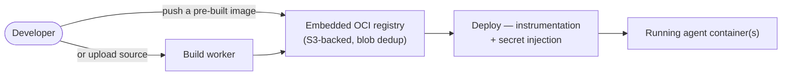

The [lifecycle guide](/build/overview) covers building and deploying agents. This page covers how those containers are hosted.

## The two runtimes

<Warning>
  **Enterprise feature.** The Kubernetes/KEDA runtime below is `nasiko-ee` only — the open-source
  `ContainerRuntime` implementation is Docker-only (no Kubernetes feature or dependency at all).
  `AGENT_RUNTIME=kubernetes` has no effect in an OSS-only install.
</Warning>

Selected with `AGENT_RUNTIME`. The Nasiko server's contract is the same either way: deploy, scale, restart, fetch logs, route traffic.

<CardGroup cols={2}>
  <Card title="Docker" icon="docker">
    Single-replica, reached at `localhost:port` on the Nasiko server host. No cluster to operate — right for local development and single-machine deployments.
  </Card>
  <Card title="Kubernetes" icon="circle-nodes">
    Deployments and Services, reached at the Service's cluster DNS name. KEDA-driven autoscaling via min/max replica annotations, secrets refreshed before scale-up, in-cluster build pipeline.
  </Card>
</CardGroup>

| Operation | Behavior |
| --- | --- |
| Deploy | No-op if the image is unchanged, atomic replace if it changed. Returns observed status immediately — on Kubernetes a pod may still be `Pending`, so poll separately for `Running`. |
| Scale | `0` stops the agent. **Under Docker, any count above `1` is clamped to `1`.** Use Kubernetes for horizontal scaling. |
| Restart | Docker recreates the container; Kubernetes triggers a rollout restart. Either way, this is how a running agent picks up rotated secrets. |
| Status | A missing resource reports `Unknown` rather than erroring, so polling needs no special case. |
| Scale-up | Secrets are re-injected before new replicas start — no replica comes up with stale credentials. |

Instrumentation is applied uniformly regardless of runtime — see [observability](/dashboard/sessions-and-traces).

<Note>
  Agent secrets are AES-256-GCM encrypted at rest and decrypted into a container's environment at deploy time. Plaintext never touches disk outside the running container's memory.
</Note>

## Two on-ramps, one deployment path

- **Push a pre-built image** — `nasiko push` / `nasiko deploy` build locally and push layers and a manifest to the embedded `/v2/*` OCI registry (S3-backed, blob dedup across layers), then request a deployment.
- **Upload source** — `nasiko upload` (or `POST /api/agents/upload`) ships an archive; the platform builds server-side, off the request path.

Both land in the same place. Deploying wires up networking, injects decrypted secrets, and instruments the container — no change to the agent's code.

## Server-side builds

Uploads are queued and picked up by a background worker, so a slow build never holds a client connection. You get a build ID immediately and poll for progress, or watch it on the [Builds screen](/dashboard/agents#builds).

- **A failing build can't take others down.** Each build runs isolated from the worker's scheduling loop — a crash resets just that job.
- **Retries cap at three attempts.** A job that exhausts them is marked `failed` immediately, so nothing polling hangs forever.
- **Orphaned builds are recovered.** A periodic sweep finds jobs still in-progress past any plausible build time — the signature of a replica that died mid-build — and resets or fails them.

The same pipeline handles [uploaded MCP servers](/build/mcp/deploy-server), which also get OS-level hardening and network segmentation.

<Note>
  In-progress image pushes are buffered on the instance that received them, so a push is sticky to that instance. Behind a load balancer, use session affinity for `/v2/*` traffic or large pushes will fail when split across replicas.
</Note>

## Related

<CardGroup cols={2}>
  <Card title="Agent Development Lifecycle" href="/build/overview">
    Scaffolding, running locally, deploying, versioning.
  </Card>
  <Card title="Agents in the dashboard" href="/dashboard/agents">
    Deploying, scaling, and watching builds.
  </Card>
  <Card title="Observability" href="/dashboard/sessions-and-traces">
    Traces, cost, and the configuration behind them.
  </Card>
  <Card title="Access control reference" href="/governance/access-control/reference">
    Who can deploy, update, or manage an agent.
  </Card>
</CardGroup>
