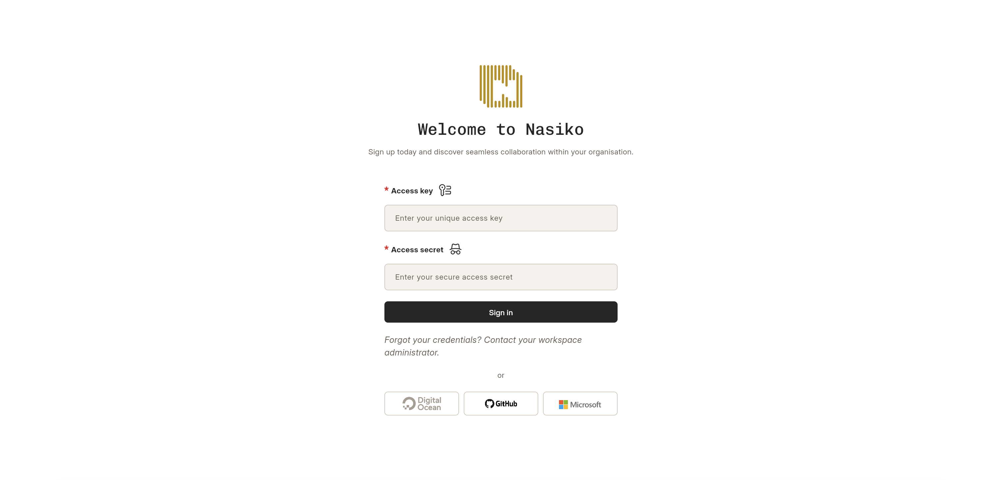

You need two things: a control plane to connect to, and an account on it.

<Steps>
  <Step title="Get a control plane">
    If your organization runs one, get its URL from your administrator. Starting fresh? `nasiko up` runs one locally — see [Quickstart](/quickstart).
  </Step>
  <Step title="Get an account">
    An administrator creates it and gives you a one-time access key and secret. The secret is your login password — save it, it isn't shown again. See [ACL](/onboarding/acl/overview).
  </Step>
  <Step title="Sign in">
    CLI: `nasiko auth login` ([Setup Your CLI](/cli/setup)). Dashboard: sign in at your control plane URL ([Dashboard](/product/overview)). Same account, either surface.

    <Frame>
      
    </Frame>
  </Step>
</Steps>

Next: [Quickstart](/quickstart) to deploy your first agent.
